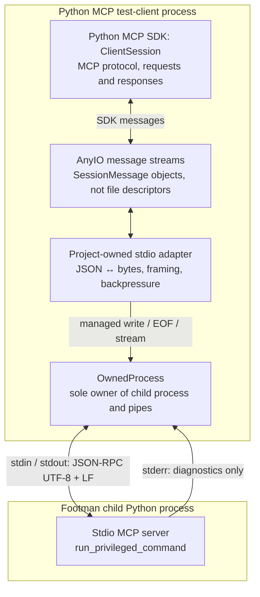

# Design

## Context

See proposal.md for motivation. This is a standalone tool for an arbitrary Git repository. The operator provides a prepared Docker image and a configuration file containing a container-launch command template. The dispatcher need not understand what the configured command does or how the project organizes tests.

## Goals / Non-Goals

**Goals:** Export the staged source state, execute one configured command inside a container as a configured privileged user, retain exact output/status, and expose it through one stdio MCP tool.

**Non-Goals:** Test discovery, test-count interpretation, assessment of verification completeness, project-specific prerequisites, image building, application provisioning, package lifecycle management, workflow orchestration, arbitrary agent-supplied commands, or a malicious-code sandbox. Staging is a mistake guard, not security approval. The exported source has no development Git metadata; builds requiring it are unsupported.

## Decisions

### 1. One MCP server engine and an operator-owned configuration file

The host-side stdio MCP server owns configuration, snapshot capture, Docker execution and results. Use Python 3.14+ and standard-library `uuid.uuid7()`; do not introduce a UUID compatibility implementation. The pinned MCP SDK is an implementation choice.

Use a strict versioned TOML configuration file. Example:

```toml
version = 1
repository = "/path/to/repository"
container_start_argv = [
  "docker", "run", "--detach=true", "--pull=never", "--",
  "{image_id}", "sleep", "infinity"
]
# Illustrative only: replace with the actual full local image ID.
image_id = "sha256:0123456789abcdef0123456789abcdef0123456789abcdef0123456789abcdef"
user = "root"
command_argv = ["cargo", "test", "--locked"]
working_directory = "."
snapshot_directory = "/path/to/host/snapshots"
container_snapshot_directory = "/workspace"
output_dir = "/path/to/results/{phase}/{utc_datetime}"
timeout_seconds = 3600
cleanup_grace_seconds = 10
```

Paths, image and keep-alive command above are illustrative, not defaults tied to a particular machine. The image must supply an appropriate long-running main process. Resolve relative host paths against the configuration file directory, not the caller cwd. Canonicalize the repository and external host storage roots. Require snapshot/output storage outside the development repository; reject overlapping storage roots that could mix logs and exported inputs. `working_directory` is relative to the exported source and must resolve inside it. The container snapshot root is the absolute destination for copying the staged snapshot inside the container. Every run has its own temporary host snapshot and dedicated container. `container_start_argv` follows the constrained literal argv grammar `docker run --detach=true --pull=never [OPTION ...] -- {image_id} [COMMAND_ARG ...]`. The first four elements are exactly `docker`, `run`, `--detach=true`, `--pull=never`; wrappers, alternate executables and Docker global options are outside this grammar. Before the mandatory standalone `--`, every additional option is a single `--name=value` argument with a nonempty name (containing no `=`); split at the first `=`, preserving the value, including an empty value or additional equals signs. Reject bare flags, short options, separate option values and any additional option named `detach` or `pull`, including a repeated `--pull=never`. Missing or conflicting pull policy is a startup validation error. Required `--pull=never` disables implicit image pulling even if Docker interprets an unresolved hexadecimal operand as an image name. Docker validates option names and values at launch; this structural validation is not a complete Docker option parser. Immediately after that delimiter require the standalone `{image_id}` argument. Require exactly one occurrence of this placeholder in the whole template; reject it in option values, embedded strings or command arguments. The remaining arguments, if present, are literal container command/arguments without placeholders; a later `--` there is a command argument. Replace only the image operand with the configured image ID, without shell evaluation, word splitting or recursive substitution. Validate this shape at server startup before acquiring run resources. Reject every `{snapshot_path}` occurrence as an unknown-placeholder startup error, including in a template that also contains `{image_id}`. The launch argv contains no substituted host snapshot path; that path is used later by copy. The validated operand position makes the configured ID the Docker run image, rather than merely a value appearing somewhere in launch argv. Source transfer uses the Docker CLI. `command_argv` and `container_start_argv` are nonempty arrays whose every element must be a nonempty NUL-free string, not only the executable. An empty string or NUL in any position is a startup configuration error before serving requests or acquiring run resources. This does not forbid an empty option value inside a nonempty argument such as `--name=`. `command_argv` is not restricted to any build tool. For example, `["cargo", "test", "--locked"]`, `["./gradlew", "test"]` or `["npm", "test"]` can be configured. There is no implicit shell parsing, substitution or agent override. The image must provide the executable or the snapshot must contain it, as with a project wrapper. User defaults to `root` and is recorded; the operator is responsible for configuring the intended privileged identity. Timeouts/grace are positive bounded values. Reject unknown fields, unsupported versions and statically invalid values/paths at server startup, before serving any request. On startup validation failure, exit nonzero, report the validation error on stderr, create no run output directory or snapshot, and start no container or configured command.

`image_id` is required and accepts either a full Docker image ID (`sha256:` followed by exactly 64 hexadecimal characters) or an unprefixed ID of 12–64 hexadecimal characters, such as `d9e853e87e55`. Validate the entire string; reject missing, non-string, malformed, out-of-range or tag-valued IDs at startup, before serving requests or creating run resources. Format validation alone does not establish image existence or container identity. Include the configured value in the effective configuration identity and substitute it literally into `{image_id}`. Docker performs local resolution at launch. Literal substitution and `--pull=never` do not guarantee ID-only resolution: a local hexadecimal-name tag such as `d9e853e87e55:latest` can resolve instead of the intended ID, including when that ID is absent. Footman does not enforce image-identity equality; the operator is responsible for avoiding conflicting local names. A Docker resolution error fails dispatch and prevents copying and configured-command execution.

Obtain an image ID from the `IMAGE ID`/`ID` column of the local image listing (for example `d9e853e87e55`):

```sh
docker image ls
```

Alternatively, obtain the full ID of an operator-prepared local image by its tag:

```sh
docker image inspect --format '{{.Id}}' footman-sandbox:latest
```

Copy the listed ID or the full inspection output into `image_id`. After rebuilding the image, obtain its ID again, update the configuration and restart Footman. Launches use the configured ID until restart; Docker resolves an abbreviated ID against the images available at each launch. The operator-owned launcher uses `{image_id}` as its image argument. Footman does not build or pull images to validate this field.

Configuration is loaded and validated once at server startup and remains immutable for every request served by that process. Subsequent TOML file edits have no effect on the running process; a new configuration is loaded and validated only after server restart. Configuration immutability does not freeze the filesystem or Docker state: retain per-request checks for expanded paths, exclusive output/snapshot reservation, path disappearance or symlink replacement, and actual container identity/running-state inspection and snapshot transfer. Failures detectable only then are request-level failures with retained diagnostics and applicable cleanup, not startup errors. Do not reserve per-run directories, capture snapshots or launch containers merely to validate startup configuration. Record its effective non-secret identity with the result. The agent cannot select containers, argv, arbitrary paths, users or timeouts. An optional `phase` label affects only output organization as defined below, not execution configuration. No source repository configuration file is automatically evaluated as dispatcher configuration.

### 2. Export a fixed staged snapshot

Before index capture, exclusively create the source directory at `<canonical snapshot_directory>/<run_id>` using the identity defined in §5. Resolve and enforce confinement under the canonical snapshot root, without traversing symlink replacements. An existing destination (including a symlink) or concurrent reservation collision fails visibly before capture/launch; do not reuse it, regenerate the ID or rename the directory. A failed reservation grants no ownership: never modify or delete that destination. Only the request that successfully reserved a directory may export into or clean it up. Independent requests use distinct reserved paths.

Capture the repository's actual index in a private temporary index; derive one tree using `GIT_INDEX_FILE` pointing at the private copy. A direct `git write-tree` can update index cache metadata, so never run it against the development index. Sanitize inherited Git repository/index redirection. Support ordinary and linked-worktree repositories, and handle split indexes explicitly or fail with an unsupported-format diagnostic. Reject unresolved index entries.

Read one opened index version and detect inconsistent capture rather than mixing versions. Git normally replaces indexes atomically during staging. After capture, later staging or workdir edits do not affect the run. Record the full tree ID and Git object format; HEAD is optional context, not the tested content identity. Creating tree objects is permitted; creating commits or refs, registering worktrees, applying patches and changing development files/index bytes are not.

Export raw NUL-delimited tree entries and blob bytes into a new directory. Do not copy contents from the workdir. Include staged additions, modifications and deletions; exclude unstaged-only content, untracked files and ignored build output. Interpret each Git entry by mode, rather than writing every blob as a regular file:

- `100644` / `100755`: create a regular file with exact blob bytes and the corresponding non-executable/executable file mode.
- Tree entries (`040000`, commonly rendered `40000`): create directories and descend into tree entries. Git does not retain arbitrary directory permission bits; use safe host permissions, not fabricated source directory modes.
- `120000`: read the blob as the symlink target and create an actual filesystem symlink, not a regular file containing target text. Validate that the target resolves within this snapshot, including link chains; reject absolute/outward targets, cycles or targets whose containment cannot be established. Use filesystem-byte-preserving target handling, or explicitly reject unsupported targets. Check containment without following links during export writes; a lexical `..` check alone is insufficient.
- `160000`: reject gitlinks explicitly. Reject unsupported entry modes rather than coercing them to regular files.

Avoid checkout conversions, smudge filters, hooks, `export-ignore` and `export-subst`; do not run consumer executable code on the host. Reject gitlinks, unsafe paths and outward symlinks; never follow exported symlinks while writing. Preserve unusual file names or reject unsupported names explicitly.

The snapshot has no `.git`. Required generated output and dependencies are handled by the configured command and prepared environment, not copied from the development tree. The dispatcher does not add build steps or infer missing project inputs.

### 3. Launch a dedicated container and execute the command

After completing the snapshot, expand and execute `container_start_argv` on the host using literal argv, closed stdin and no TTY. The validated template launches a new dedicated container from the literal `{image_id}` operand with mandatory `--pull=never`. Resolve against local images only, accepting Docker's name/ID resolution semantics and the local-name collision risk in §1. A Docker resolution error fails launch with retained diagnostics, without pulling, retrying with a name/tag, rewriting the operand or proceeding to inspect/copy/exec. A successfully resolved conflicting local name is not rejected by Footman; image inspection is diagnostic-only for image identity and does not guarantee that the intended ID was selected. Footman never invokes a separate image pull as a fallback. Snapshot copying follows successful launch and inspection. The startup command has this contract:

- Exit zero means launch succeeded; stdout contains exactly one full Docker container ID (64 hexadecimal characters), optionally followed by one newline. No banners, extra lines or container logs are allowed there.
- Diagnostics go to stderr. Nonzero exit means startup failed; the configured command must not run even if stdout contains an ID.
- The container remains running for subsequent `docker exec`; launch success alone does not imply application readiness. The configured image/entrypoint must be ready for the configured command without an inferred domain-specific readiness check.
- The returned ID belongs to the new container created for this request. The dispatcher may inspect, execute in, and remove that container; returning a shared or unrelated container is a configuration-contract violation.

Validate startup output, then perform one launch-validation inspection through `OwnedProcess.launch`, with closed stdin and only the remaining request deadline:

```text
docker container inspect --format {{.Id}}|{{.State.Status}}|{{.Image}} <container-id>
```

The format string is one literal argv element. Accept exactly one record with at most one trailing LF. Parse the first two pipe-delimited fields as container ID and status; the optional remainder is image metadata. Require a full 64-hex container ID equal to the launch ID (hexadecimal case insignificant) and status exactly `running`. Nonzero inspect status, missing/unparseable ID or status, a different ID, extra records or non-running state fails dispatch before mkdir/copy/command execution. With valid mandatory fields, absent/empty/malformed image metadata is unknown plus a diagnostic; a usable value is a full `sha256:<64 hex>` ID. Record inspect argv/status and bounded stdout/stderr excerpts plus parse diagnostics as infrastructure-summary observations using the result.json protocol in §5. Use this single result for container validation and image attribution; cleanup confirmation uses the separate pinned rm/container-listing protocol below in §3.

Validate the exact container ID and running state before executing the configured command. Record configured `image_id` and the full observed `Image` ID (`sha256:` plus 64 hexadecimal characters) from container inspection separately for attribution, including when configuration uses an abbreviated ID. Record unavailable or unusable observed identity as unknown with a diagnostic. Container identity, running state and successful inspection remain required. Missing/malformed/extra startup stdout, failed container inspection, a mismatched container ID, a non-running container or failed snapshot copy is dispatch failure; retain the attributable container ID for applicable cleanup rather than retrying launch. Record startup argv, exit status and complete startup stdout/stderr separately from the configured command's output. If a failed/timed-out startup created a container without returning a valid attributable ID, report potentially unresolved resources for operator reconciliation; do not guess an ID, rerun startup or remove unrelated containers.

Copy the complete exported staged snapshot into `container_snapshot_directory` of that exact container before exec. Transfer the snapshot contents, not an extra enclosing run-ID directory or the development workdir. Preserve exact regular-file bytes, executable modes and actual internal symlinks without dereferencing them; exclude `.git` and unstaged/untracked/ignored inputs as established by export. Use this ordered literal-argv protocol through `OwnedProcess.launch`, with closed stdin:

```text
docker exec -u root <container-id> mkdir -- <container_snapshot_directory>
docker cp <canonical-host-snapshot>/. <container-id>:<container_snapshot_directory>/
```

Operator documentation and the annotated configuration example must explicitly state that the destination's parent must already exist inside the running container. For example, `container_snapshot_directory = "/workspace/source"` requires an existing `/workspace` directory, while `/workspace/source` must be absent. The image or operator-controlled startup prepares the parent before Footman's copy step. Footman creates only the final directory using `mkdir` without `-p`; a missing parent fails preparation, prevents copy/command execution and triggers applicable container cleanup.

The prepared image must supply `mkdir` supporting `--`. The operator supplies an existing directory parent for the configured absolute destination, with directory-only, symlink-free ancestors, and ensures that the container's keep-alive/background processes leave that path unchanged throughout preparation and copying. These are operator prerequisites, not race-proof containment guarantees enforced by Footman inside the container. The final destination must initially be absent. `mkdir` creates that one directory and fails if it already exists or its parent is missing; copying starts only after its zero exit status. The `/.` source suffix copies snapshot contents directly into that new directory. Copy preserves regular-file bytes, executable modes and actual internal symlinks using Docker's ordinary copy semantics. Record both argv/statuses and bounded diagnostic excerpts in the infrastructure summary defined in §5. Any preparation or copy failure, including partial transfer, prevents configured-command execution and enters known-ID cleanup, without retrying launch or copy. Use absolute canonical host source paths and absolute in-container destinations as literal argv, including spaces, colons and newlines. These characters are valid copy-path content and must not be rejected at startup or per request. Reject NUL, non-absolute paths or a host source whose canonical identity cannot be resolved/validated under the existing snapshot contract; container path existence/access is established by mkdir/copy. Filesystem and Docker failures retain their actual diagnostics. Phase 5 tests the protocol at the stub boundary; Phase 11 establishes actual bytes/modes/symlink copy behavior. Host snapshot export and cleanup retain their existing capability-based containment guarantees.

Preparation runs as root, and ordinary host-to-container `docker cp` creates copied entries with container-root ownership rather than preserving host uid/gid. Document this in operator prerequisites and the annotated TOML. A non-root configured user needs directory traversal/read/execute permissions and whatever write access its command requires; root ownership alone does not decide whether a command can run. The operator arranges suitable image/filesystem permissions or a deliberately configured command wrapper/permission step. Footman does not infer a uid/gid or add automatic chown/chmod. Missing access is reported through preparation or command failure. The default configured execution user remains root; non-root identities remain supported when the operator supplies the required access.

Validate the working directory inside the copied snapshot and invoke literal argv, conceptually:

```text
docker exec -u <configured-user> -w {container_snapshot_directory}/{working_directory} <container-id> <command_argv...>
```

The `-w` value is a normalized in-container path below the configured in-container snapshot destination: for example `/workspace/subdir` for `container_snapshot_directory = "/workspace"` and `working_directory = "subdir"`, or `/workspace` for `"."`. Validate containment in the container path namespace. The dispatcher must never substitute the host snapshot path into exec argv; it is used only for host export, snapshot copying and cleanup.

Do not use `-i`, `-t` or shell interpolation. Close stdin and keep stdout/stderr separate. Configuration determines the complete command; the dispatcher adds no feature flags, test filters, target selection or test-layout requirements. Check only generic execution prerequisites: Docker availability, successful launch contract, configured identity availability, copy-destination/working-directory access and executable availability. Domain-specific UID/group/ACL or other probes belong to the invoked command, if needed.

Each request uses a fresh host snapshot and its own container, so no shared-container serialization is required. Use fresh build output within the container's copied snapshot so a previous compiled executable cannot stand in for it. The image supplies the toolchain and configured dependencies/caches; the tool does not claim hermetic builds. Command-generated files stay inside the dedicated container and disappear on removal; they do not modify the host snapshot.

`timeout_seconds` covers startup, inspection, snapshot copying and command execution; bounded cleanup has a separate configured `cleanup_grace_seconds`. Both are positive bounded configuration values with documented validation limits. Local `docker exec` termination does not prove the child exited. On every terminal path after an attributable container ID is known, run literal `docker rm -f <recorded-id>` and then literal `docker container ls --all --no-trunc --filter id=<recorded-id> --format {{.ID}}` to confirm removal. Each format/filter value is one argv element, stdin is closed, and both operations fit the one cleanup allowance including local reserve. Confirmation requires exit zero, complete successful stdout collection and exactly empty stdout. A single full ID equal to the recorded ID (optionally followed by LF, hex case insignificant) means the container remains; unexpected/malformed output, any nonzero status, transport failure, read failure or timeout leaves removal unconfirmed. Record rm failure even if subsequent listing confirms absence; confirmation determines resource absence, not aggregate success. Attempt confirmation after an ordinary rm failure if the same cleanup budget permits. Use these separate cleanup rules rather than launch-inspection parsing or a nonzero inspect status. Perform no guessed-ID removal, replacement helper retries or renewed cleanup budgets. Preserve command outcome and cleanup failure separately; an unconfirmed cleanup prevents aggregate success. Retain the host snapshot until container cleanup is confirmed. Snapshot cleanup must not follow symlinks or broaden into other paths; report retained paths if host removal fails. Container-generated root-owned files remain inside the container; confirmed container removal accounts for them. Record unresolved resources for operator reconciliation rather than killing unrelated processes or claiming success. On disconnect, a started run stays supervised to a recorded outcome, with no automatic retry. An interrupted dispatcher leaves an incomplete result with any known container ID and snapshot path for reconciliation.

### 4. MCP tool with an optional output label

The operator starts the stdio MCP server as:

```text
footman --config <config.toml>
```

MCP exposes `run_privileged_command` with input schema:

```json
{"type":"object","properties":{"phase":{"type":"string","pattern":"^[A-Za-z0-9_-]+$"}},"additionalProperties":false}
```

The tool invocation supplies either `{}` or an object containing only `phase`. The server loads one configuration at startup, and every tool invocation uses that fixed configuration and result contract. The label is optional unless `output_dir` contains `{phase}`; then missing phase is an input error. It is a nonempty string matching `[A-Za-z0-9_-]+`, without fixed semantic values; dots, slashes, backslashes and traversal components are rejected. A supplied label is recorded even if the template omits it. Phase never selects commands or changes launch/command argv. Reject invalid labels, unknown fields and missing required phase before reserving output, snapshot capture or Docker execution. MCP stdout is reserved for protocol messages; diagnostics use stderr or retained files. A failed run returns a structured unsuccessful tool result, not an unexplained server crash. The tool result reports `outcome`, nullable command `return_code`, and absolute paths for every created `stdout.txt`, `stderr.txt`, `startup-stdout.txt`, `startup-stderr.txt` and `result.json`; outcome remains separate from the return code for failures that do not start or complete a command.

#### Server-side inherited stdio ownership

Record this inherited-stream borrowing category in the durable `docs/process-lifecycle.md` contract, including its facade and cleanup boundaries; the Phase-9 documentation and ownership audit must verify that home and its lifecycle links/anchors. The Footman process runtime retains ownership of its inherited `sys.stdin`, `sys.stdout`, `sys.stderr` and their underlying buffers. The production server borrows them; it must not close, independently adopt or create additional fd-owning wrappers over them. The pinned SDK's server-side `mcp.server.stdio.stdio_server` is permitted only when both `stdin` and `stdout` are explicitly supplied as borrowed async text facades: these facades acquire no fd-owning stream, never release inherited handles, and implement UTF-8 newline framing independently of locale through the borrowed binary buffers. Do not invoke the SDK's default path, which constructs deliberately unclosed `TextIOWrapper` objects over the inherited buffers. Memory streams/tasks introduced by the adapter have explicit scoped cleanup; failure, interruption and repeat cleanup must not close runtime-owned handles or depend on wrapper garbage collection. Any new actual fd-owning resource still requires its sole foundation owner and the full branch fault matrix.

This server-side permission does not permit the client SDK's subprocess-owning `stdio_client`. Only serialized JSON-RPC messages may reach server stdout. Logging, startup refusal, exception diagnostics and ordinary messages go to stderr or retained files; no banners or debug prints go to stdout. Server adapter tests must assert protocol-byte purity and stderr separation, borrowed-stream setup/failure/interruption/repeat-cleanup behavior and UTF-8 framing, separately from the test-client subprocess ownership audit.

#### Test-client stdio transport (Phase 9; depends on completed Phase 8)



This client transport lives in `tests/mcp_transport.py`, not `src/footman/`; it is test infrastructure, not a production component required to use Footman. Production MCP clients connect through their own stdio transports. The test client uses the real Python MCP SDK, which receives message streams, not file descriptors or child-process control. The adapter invokes the managed OwnedProcess API; only OwnedProcess owns/releases the child pipes and signals/reaps the child.

Use the pinned MCP SDK's real `ClientSession` to initialize, discover and call tools over the executable's actual stdio JSON-RPC connection. Supply its message streams through a project-owned transport adapter backed by `OwnedProcess.launch`; do not use or monkeypatch the SDK's `stdio_client`, which independently launches, closes, signals and reaps its child. In-memory sessions alone do not establish executable/stdio delivery. Reuse this transport for later integration and host acceptance rather than introducing another subprocess owner. Declare its complete transitive test-support closure; the isolated host workspace copies at least `tests/__init__.py`, `tests/green_skip_policy.py`, `tests/mcp_transport.py` and those dependencies. In isolated installed-wheel contexts the transport imports that wheel's process foundation, never checkout src/ or an editable package; development runs explicitly attribute imports to the checked checkout/environment as defined below. All copied transport/support files fall under the existing tests/ source identity scope and post-copy/completion identity rechecks; host contracts must detect omissions or a fallback process owner.

**Server launch and same-child provenance.** Define reusable test-support bootstrap `tests/mcp_server_child.py`. It runs inside the sole server child and verifies the exact full Footman-package Python-source set against the intended root, manifest paths and digests using the child-side procedure below (not merely footman/startup/process/__main__), emits a bounded provenance record only on stderr, then dispatches the selected public entry point in that same process. Verification failure exits nonzero before serving requests. It introduces no subprocess, production MCP tool, production startup flag or stdout metadata. Its only lifecycle-specific option is test-bootstrap-only --lifecycle; existing --expected-origin/--entrypoint inputs remain test-bootstrap options too. The production entrypoint must reject --lifecycle and other unknown options without exposing lifecycle capability. Parent-side import checks alone are insufficient.

Development server checks (including integrated staged-fixture tests) launch the absolute running interpreter path `sys.executable` without resolving away its virtualenv identity, with argv `[python, "-P", absolute_tests_mcp_server_child, "--expected-origin", expected_manifest, "--module", "footman", "--", "--config", absolute_config]`. The bootstrap executes `runpy.run_module("footman", run_name="__main__", alter_sys=True)` with the service argv after verification. Expected module paths/digests must derive from the checked checkout's src/footman in development, not be accepted from whichever Footman happens to import. Remove inherited PYTHONPATH and other test-unrelated import redirection from an explicitly constructed child environment; a poisoned-import/PATH negative control must fail or be neutralized without exercising another installation. Development installation may be the documented editable venv; record it as such rather than claiming wheel provenance.

Isolated exact-wheel checks and host acceptance use the runner-created venv's absolute python and installed console-script path, with argv `[venv_python, "-P", copied_tests_mcp_server_child, "--expected-origin", expected_manifest, "--entrypoint", absolute_venv_footman_script, "--", "--config", absolute_config]`. This is the canonical direct-wheel variant, required for isolated exact-wheel checks and real host acceptance, which omit --lifecycle; direct development also omits it. The canonical nested-relocated wheel variant is `[venv_python, "-P", copied_tests_mcp_server_child, "--expected-origin", expected_manifest, "--entrypoint", absolute_venv_footman_script, "--lifecycle", absolute_lifecycle_input, "--", "--config", absolute_config]`. The nested relocated leg must use this variant, inserting --lifecycle and its single absolute input path immediately before the -- separator. Exact-argv controls reject omission in the nested leg, addition in ordinary direct dispatching service legs (development, isolated exact-wheel and real-host acceptance), duplication, wrong position or forwarding the option past -- to production. Phase-9 bootstrap lifecycle-option contract tests are an explicit required exception: use the canonical lifecycle-enabled wheel variant above with Phase-9-owned disposable wheel/install fixtures, without depending on Phase-10 orchestration or its later build fixture. Exercise successful journal/EOF/lifetime behavior and non-dispatching input-validation/journal-publication fault launches; the latter retain the same argv shape but use deliberately faulty inputs or injected journal operations. Invalid input rejected before journal acquisition leaves no journal; publication/write/close/interruption failure may leave a partial journal and must prevent attestation/dispatch while preserving failure and resource accounting. Phase-9 audit/VALIDATE evidence must name the executed lifecycle input/journal/incarnation/exit and both argv-variant control nodes. Phase 10 maps/regresses those bootstrap primitives and first adds relocated-helper orchestration/loss integration, recording its own new node IDs rather than inventing Phase-9 antecedents for that integration. The bootstrap executes that exact script via `runpy.run_path(..., run_name="__main__")` in the verified server child; it does not start a second child or resolve a bare footman/python through PATH. Verify same-child module bytes against expectations derived from the bound wheel archive, and verify the installer-generated script's path/entry-point semantics against that wheel's entry_points metadata, recording its installed digest separately rather than pretending the script bytes are wheel archive members, with PYTHONPATH omitted, clean external cwd and no checkout injection. Retain bootstrap stderr provenance with launch argv and environment attribution; parser tests must reject missing/mismatched provenance. Keep direct console-script/module help and installation smoke checks as independent tests, not replaced by the bootstrap. The copied host support closure includes tests/mcp_server_child.py and its declared dependencies in source/copy/completion identity checks.

**Expected-origin manifest authority.** Use versioned JSON with `schema_version: 1`, `context: "development" | "wheel"`, `wheel_sha256: string | null`, `modules: [{name, source_path, expected_path, sha256}]` and `entrypoint: null | {script_path, target, observed_script_sha256}`. Require module entries for footman, footman.startup, footman.process and footman.__main__ with canonical absolute expected paths and SHA-256 of source bytes. Define the provenance scope as all importable Python source modules of the Footman package, including filesystem submodules and the dispatched entry module; generate entries from checked src/footman or verified wheel package members accordingly, accepting that declared package scope rather than rejecting valid additional Footman modules. Reject malformed, duplicate, missing required/package entries and entries outside that scope. SDK, dependencies and stdlib are outside this package-byte provenance assertion and retain their separate pinned-environment checks. In development, the test fixture writes it from checked checkout src/footman paths/bytes, never ambient imported module locations. For isolated wheel tests their fixture, and for host acceptance the runner, writes it from the exact --wheel artifact after independently verifying its SHA-256 against the controlled build manifest (or the recorded exact-build binding in development wheel smoke).

Wheel module `source_path` values are validated relative archive member names and their sha256 values are computed directly from those members' bytes, not from installed site-packages, installed RECORD hashes or child self-reporting. Map archive package members to the intended fresh venv's install scheme to derive expected_path; verify the installed files and child origins against these independent expectations. Read the archive without executing members or traversing unsafe paths and reject ambiguous mappings. A self-consistent stale/copied installation must fail even when the supplied wheel itself matches its build binding. Test stale module bytes, swapped/copied install, malformed expectations and wheel-versus-build-manifest digest mismatch separately.

The console script is generated by the installer, not generally stored verbatim in the wheel. Derive target from the verified wheel's entry_points metadata, require the intended absolute venv script location and validate its supported launcher structure dispatches that exact target without extra behavior before executing it; fail closed for unsupported/mismatched launcher forms. observed_script_sha256 is installed-script attribution, not an independent wheel-byte expectation. Retain the direct installed console-script smoke separately. This guards accidental stale/mixed installations, not maliciously forged provenance.

Generate expected-origin files exclusively under recorded fixture/runner scratch paths outside source-identity roots, never in the checked src/tests/scripts trees or an identity input. Treat them as generated output and reconcile only their recorded resources. They may be retained inside the external evidence directory as provenance inputs; identify them as generated expectations, not independent proof authored by an operator. Use sole owners and the existing acquisition/failure/cleanup matrix for reads, writes and archive inspection. Keep expected-origin authority independent of the child it checks.

**Child-side full-package verification.** First resolve the footman package spec and require its origin/search root to equal the canonical expected installation root from the independently generated manifest, not whichever package ambient imports select. Verify the package initializer's bytes before trusting the root. Enumerate every regular *.py recursively below that root, including filesystem/, using sole-owned no-follow directory/file reads without importing the modules. The identical enumeration policy applies to checkout/archive manifest generation: reject symlinked roots, directories or Python-source entries and unsupported special nodes; never follow symlinks silently. Ignore declared non-source entries such as __pycache__ and bytecode for this source-set comparison without treating them as verified source. Require an exact one-to-one relative-path/module-name/digest match with the manifest: missing, unexpected/extra, duplicate mappings and stale bytes all fail before service dispatch or the first protocol message. Check imported Footman origins, when present, also lie at those verified paths. This is an accidental mixed-install/source provenance check, not a malicious importer or concurrent-mutation sandbox.

The immediate parent of the service child (the test fixture/acceptance runner in direct flows, or the fresh-venv relocated-client helper in the nested flow below), never the service child, writes the complete verified path/digest set to a generated external provenance evidence file under its recorded scratch/evidence directory. It chooses and records the absolute path; the child receives no evidence-output path or release authority. The parent constructs the set from its independently generated expected-origin manifest but may label it child-verified only after matching the child's complete bounded stderr attestation. A parent-only expected set is not verified evidence. Add controls preserving initializer/startup/process/__main__ while changing container.py or supervision.py, plus missing and extra *.py controls, symlink rejection and wrong-package-root controls. All must fail before protocol service. Record the exact verified package scope and control results in development, relocated-wheel and host evidence, not merely the former three-module subset.

**Provenance evidence format and lifecycle.** Canonicalize the package set as an array of objects with exactly `path` (package-relative POSIX source path) and `sha256` (lowercase hexadecimal source digest), sorted by path with duplicate/unsafe paths rejected. Serialize to UTF-8 JSON using `sort_keys=True`, `ensure_ascii=True`, `separators=(",", ":")` and no trailing newline; SHA-256 covers exactly those bytes. Both bootstrap and parent use this representation. The bootstrap emits exactly one stderr attestation only after full package verification succeeds and before service dispatch. Failed verification emits no attestation and exits nonzero with an ordinary stderr diagnostic; the parent records absence, diagnostic and actual exit status separately and fails provenance closed. Arbitrary package growth affects the external set, not attestation size.

**Attestation emission and namespace ownership.** The test bootstrap constructs the complete canonical ASCII record in memory within the 512-byte limit, then uses the borrowed inherited binary stderr for one complete write call followed by flush, after verification and before dispatching service code or starting SDK/server tasks/logging writers. No new fd/OwnedStream/OwnedDescriptor or release authority is acquired for inherited stderr. Require the write result to equal the entire record length; a short write, write exception, flush failure or interruption makes bootstrap delivery fail nonzero (preserving interruption authority) without re-emitting/retrying the record or dispatching the server. A single write call alone is not a guarantee of full/atomic delivery; ordering excludes competing writers, and parent parsing still tolerates callback chunk boundaries and rejects incomplete records. Test full/short/write/flush/interruption and repeat cleanup without inherited-handle release or duplicate attestation.

Reserve line-start FOOTMAN_PROVENANCE_ exclusively for this test-bootstrap record. Footman's generated diagnostics, logging (including multiline exception formatting), configuration/startup refusals and generated helper-failure reports must never begin a physical stderr line with that prefix. Use an explicit diagnostic formatting/line-prefix boundary and test actual server stderr across those branches, excluding the one legitimate bootstrap record. Configure SDK/server logging consistently; no bootstrap error diagnostic may masquerade as another attestation. This is not authorization to redact/rewrite retained raw helper, command or startup bytes: their exact-byte files remain unchanged, and raw helper output is not blindly forwarded into service stderr. Ordinary diagnostics can describe or encode such bytes without granting them reserved-line authority.

Task 9.9 records the namespace, grammar reference, emitter/diagnostic distinction and tests in a durable docs/testing.md section titled "Test-bootstrap stderr provenance"; docs/process-lifecycle.md's inherited-stdio diagnostic-separation category links to it, with links/anchors covered by tests/test_lifecycle_doc_links.py. This is a test infrastructure namespace, not a new production MCP feature or a requirement that external clients provide attestation. The server's own diagnostic-format guard is documented there so future diagnostics cannot collide silently.

**Attestation wire grammar.** Reserve stderr lines beginning with ASCII `FOOTMAN_PROVENANCE_` for provenance. The sole valid record is `FOOTMAN_PROVENANCE_V1 ` followed by one canonical JSON object and exactly one LF, with no CR, BOM, embedded literal newline or trailing bytes. JSON has exactly schema_version (integer 1), source_count (non-boolean integer in 0..2^63-1 matching the verified set) and set_sha256 (64 lowercase hexadecimal characters); use the same sort_keys/ensure_ascii/separators serialization settings as above. The total record including prefix and LF is at most 512 source bytes. Unknown reserved versions, invalid encoding/keys/types/serialization, overlong candidate lines, missing LF and digest/count mismatches fail closed. Any second reserved-prefix line is a duplicate failure even if its version/payload is malformed; diagnostics must never intentionally emit that reserved prefix at line start.

Parse incrementally from the one full stderr stream() collection, recognizing line starts and prefixes across arbitrary callback boundaries. Keep at most 512 candidate bytes plus fixed prefix/line-state counters; discard ordinary diagnostic line bodies while continuing to drain and track their next LF, regardless of length. The parser's bound is independent of reporting excerpts, capture limits and retained diagnostic tails; none may supply or truncate its input. Distinguish malformed complete records, overlong records, unterminated reserved candidates at terminal collection, and missing records. EOF with no candidate is absence; EOF with a reserved candidate lacking LF is truncated/unterminated attestation. READ_FAILED/ABORTED/pending terminal outcomes mean incomplete stderr verification even if a full record was seen; if a candidate is also partial, report both facts without guessing unseen bytes.

A complete valid matching line is provisional and permits MCP initialization while the server remains running: do not wait for stderr EOF to start protocol exchange. Continue parsing/draining for duplicates throughout the child lifetime. Final attestation confirmation requires exactly one valid matching record, no parser failure and terminal stderr StreamOutcome.EOF; read failure/abort or an unobserved terminal outcome cannot establish that no later duplicate existed. Keep these states explicit in observations and evidence; sending/seeing one line alone is not final provenance success.

After final attestation confirmation (including clean stderr EOF), the parent exclusively writes schema-version-1 JSON evidence containing the complete canonical source-set array, source_count, set_sha256, expected-origin context/wheel binding and the matched child attestation plus server argv attribution. Adopt file/directory resources through sole foundation owners; complete writes, flush/fsync as applicable, attempt independent release once, and read back/parse/recompute the persisted set/count/digest before claiming successful retention. Evidence missing, truncated, unwritable or inconsistent with attestation is unsuccessful provenance verification, not a partial full-package success. Cover operation-plus-close, sole-close, interruption and repeat/independent cleanup for this parent-owned file branch, including parent failure after receiving valid attestation. No corrective retry or overwrite of an existing fixture destination is implicit.

If the child terminates before complete attestation, the parent may preserve generated expectations or failure diagnostics but cannot publish them as a child-verified set. If it terminates after complete matching attestation and stderr reaches clean EOF without another reserved record, provenance and subsequent process/protocol outcome remain independent: retain the verified set, report process/protocol failure separately, and never let provenance alone establish successful service delivery. Missing/corrupt final evidence still prevents a successful verification claim. Reconcile only recorded generated files using the same scratch/evidence and outside-source-identity rules as expected-origin manifests; these are generated verification inputs/results, not operator assertions or additions to Footman's five runtime result files.

**Entry-module verification.** Resolve and hash footman.__main__ source without importing or executing it: its current top level calls startup.main and raises SystemExit. Validate the dispatched entry source before runpy dispatch or the first protocol message; do not import it merely to inspect __file__. Include it in both development and wheel manifests even where the console script directly dispatches startup.main, and separately validate generated-script entry-point semantics. Add stale/mismatched __main__.py controls that fail before serving requests; retain package-scope/mapping results in development, relocated-wheel and applicable host evidence without claiming third-party import-byte verification.

**Phase-9 isolated-wheel contract fixture.** Phase 9 owns tests/mcp_wheel_support.py::build_and_install_contract_wheel, not Phase-10 support. Register its tests within tests/test_mcp_transport.py and tests/test_mcp_server.py before Phase-9 RED, including at least one real initialization/tool-discovery launch in each development and installed-wheel context. Build with exactly bare `uv build` from a recorded identity-matching disposable repository root, bind the exact successful output path and independently computed SHA-256, reject ambiguous/missing/stale-output attribution and concurrent relevant input changes, then create a fresh external venv, provision pinned dependencies and install only that bound wheel noneditably. Derive context="wheel" expectations directly from its digest-verified archive members mapped to the new install scheme; installed bytes/RECORD cannot supply expectations. Copy only the declared transport/bootstrap support closure and record source/copy/completion identities. Bound setup/subprocess durations and retain commands/statuses, artifact/input identities and resource reconciliation; missing tools/network/dependencies fail nonzero, never skip/xfail. Contract launches cover the direct-wheel and lifecycle-enabled argv variants, generated launcher semantics, poisoned origins/shadows, non-dispatching lifecycle validation/journal faults and orderly EOF/lifetime exit. New build/archive/install/copy/input/journal branches require the full matrix A from RED through Phase-9 VALIDATE.

Keep this development-only fixture independent of tests/acceptance_build_support.py and the production build helper, and out of the normal copied host closure/transport import dependencies. Phase 9 also owns tests/wheel_attribution_cases.py as inert shared case data (success, ambiguous/missing output, unrelated stale artifacts, unowned output collision, same-root double invocation and concurrent input changes), with no acquisition or import-time execution. Phase-9 tests execute all cases against its fixture; Phase 10 adds the same cases against its independent routine and compares observations, then Phase 11 adds the production helper under the existing parity contract. All paths use bare uv build from an attributed repository root, matching-input disposable roots for fixtures, pre/post input identity and exact output/status/digest binding, with refusal to overwrite unowned output destinations. Shared cases do not permit one implementation to import or substitute for another.

**Attribution-case execution and installation boundary.** Each inert tests/wheel_attribution_cases.py record declares a stable case_id, the common logical build/status/artifact/input-mutation expectations and explicit per-leg prepared-tree profiles, not an unspecified identical repository. It describes pre-existing/output artifact bytes and ownership, a scripted uv's chosen exit status/stdout/stderr, optional artifact creation and deterministic scoped-input mutation during the build. For scripted attribution cases only, Phase-9/Phase-10 repository profiles contain exactly src/, pyproject.toml and README.md as build inputs, with matching bytes for common paths; dist/ is separately declared case output/pre-existing artifact state, not an input root. Driver/evidence/tool files live outside that repository. Assert tests/, host_tests/, scripts/, uv.lock and .git are absent and irrelevant to these two attribution-only surfaces, which emit no production source-identity manifest. Use an explicit deterministic pre/post build-input inventory over the three declared paths, including recursive relative paths/kinds/executable bits/bytes/link targets without following symlinks. This minimal profile does not constrain real Phase-9/10 build/install fixtures, their provisioning inputs or their broader candidate/copy identities.

The Phase-11 scripted profile contains the same common build inputs plus exactly its production identity roots src/, tests/, host_tests/, scripts/, pyproject.toml and uv.lock: copy the tested production wrapper/implementation and its required source dependencies into scripts//src/, supply recorded fixture-owned tests/__init__.py and host_tests/__init__.py even before host_tests exists in the candidate, and use explicit case-owned uv.lock bytes. Record every supplied file rather than copying an ambient checkout wholesale. README.md remains outside the six-root source identity digest but is mandatory in the separately checked build_input_identity defined in §7; dist/, external tool/evidence paths and .git remain outside that digest. Prepare a valid disposable Git repository with a recorded resolvable HEAD using deterministic fixture author/committer metadata and a tree/commit assembled with Git plumbing without staging or touching the developer index; record the synthetic fixture revision separately from the candidate revision. The driver invokes the absolute `<prepared_tree>/scripts/build-acceptance-wheel`, not the candidate checkout's wrapper. Its attributed root is the wrapper's own physically resolved repository root, identical to its bootstrap PYTHONPATH root; the Python implementation independently derives/validates that root from its resolved implementation location. Derive revision from that prepared root, not caller cwd or an operator-provided substitute; record caller cwd but never use it to select the build/identity root. Scripted/relocated controls must record candidate-checkout dist/ inventory/identity before and after and prove it unchanged; only the recorded disposable prepared roots may be build roots in those tests. Its deterministic scoped content identity still comes from exactly the six production roots, independently of revision and absolute checkout location. Relocation tests copy the prepared inputs and Git revision metadata to another recorded path, preserving content identity; they cannot treat a missing revision or host_tests root as an expected attribution rejection.

Each driver validates its profile before invoking its public surface, records full prepared input inventory, applicable identity scope and pre/post digests, and rechecks shared-path bytes and case_id/mutation expectations. Missing/extra required inputs, unresolved fixture HEAD, incomplete wrapper dependencies or profile preparation failures are fixture/setup errors, not attributable success/rejection of the case; they fail verification nonzero. Compare common attribution outcomes and the expected stable/changed identity relation within each scope, never demand equal content digests across different per-leg profiles. Keep production-helper scope checks independent of the minimal fixture inventory; unsupported assumptions in either implementation must be repaired rather than silently supplying undeclared files.

The test driver prepares a fixture-owned executable named uv in a recorded tool directory and an explicit PATH placing it ahead of approved real Python/system tools. Record the exact PATH value, resolved uv path/script bytes/digest, prepared input/artifact identities, command, cwd, actual status and complete stdout/stderr for every invocation; assert exactly bare `uv build`, never --out-dir. Unowned-collision cases must fail before uv invocation, recorded as not attempted rather than a fabricated build status. All three public surfaces apply §7's same pre-build sdist/wheel destination prediction, collision diagnostics and no-delete rule. The shared same-root-double-invocation case runs the same prepared root twice: first attribution succeeds and records both produced artifact paths/bytes/digests; the second fails before uv invocation, names root and exact conflicting paths and leaves both artifacts and all unrelated dist entries unchanged. Assert the stub invocation count remains one and preserve both public-surface observations. Phase-9 uses attribution_only=True for both calls, never installing stub artifacts. In addition, Phase-11 Docker-free contracts repeat this pair using real uv in a disposable complete-profile root so stub parity cannot substitute for real repeat-build verification. Stub commands may create precisely the case's attribution artifacts but cannot select ambient dist candidates. These are attribution-contract tests, not evidence of a real build.

Drive Phase 9 only through tests/mcp_wheel_support.py::build_and_install_contract_wheel with explicit keyword attribution_only=True, Phase 10 through tests/acceptance_build_support.py::build_and_bind_wheel, and Phase 11 through the public scripts/build-acceptance-wheel shell wrapper as an OwnedProcess subprocess against the prepared repository root, with --manifest pointing outside identity roots. Do not call helper internals or import tests/ into production. The wrapper uses its recorded #!/bin/sh bootstrap and replaces inherited PYTHONPATH with exactly its resolved repository src/ for bootstrap Python; the uv stub is selected solely by the explicit PATH. The Phase-9 routine's default attribution_only=False performs the real build/install flow; True executes exactly the same preflight/build/parse/input-stability/hash-binding steps but returns their immutable build observation before any venv/dependency/install acquisition. Test that boundary with install/venv factories never called for all scripted cases, including success. It is a test-support keyword, not a production build-helper flag or bypass for required installed-wheel verification.

The shared driver normalizes observations, not implementation classes: accepted/rejected attribution, build attempted/status or not-attempted, exact argv/cwd, selected artifact path/digest, pre/post input identity and rejection category, plus public-surface exception or wrapper exit/manifest status. Preserve underlying outputs/statuses and any cleanup failures; compare equivalent semantic outcomes without requiring wrapper exit codes to equal Python exception types. All stubbed-tool runs, including success, stop at attribution and never feed an install or claim a usable wheel. The wheel actually installed in Phase-9 contracts, Phase-10 portability and Phase-11 host acceptance must instead come from a separately recorded real uv build with independent SHA-256 binding; an attribution-only test or stub-created manifest cannot satisfy those legs. Phase-9 RED introduces its case driver and boundary; Phase-10 RED introduces all cases for its own routine before GREEN closes them; Phase-11 RED invokes the same cases through its wrapper. Phase-9 VALIDATE must cite actual wheel fixture/launcher/lifecycle/fault node IDs and both-context protocol results; Phase-10 portability evidence additionally covers annotated configuration relocation, nested orchestration and helper loss, which this narrower contract fixture does not establish.

**Relocated-wheel acceptance before the host runner.** Register `.venv/bin/python -m pytest tests/test_dispatch_acceptance.py -n 2 --dist loadfile --tb=short -q` in docs/testing.md before Phase-10 RED, with build/installation prerequisites and the described fixture flow. Both checkout integration and relocated-wheel tests live in that one tests/ module and are collected by unscoped scripts/check-green; this is not an external or excluded acceptance leg. Keep assert_documented_suite's exact full-suite command once per checked document and all additional pytest examples parallel with one -n setting and --dist loadfile.

The module-scoped portability fixture performs one successful attributed uv build and creates one external venv/recorded scratch tree per pytest invocation. With --dist loadfile that entire module belongs to one worker, so do not use a cross-worker session fixture that builds once on every worker. Scope the success flow/negative controls to reuse that artifact with disposable copies where needed; do not recursively run this module in the new venv. Missing uv, supported Python, build/install tools or required package-index/network availability is an explicit nonzero prerequisite failure, never a skip/xfail or filtered collection. Bound helper execution and scratch resources, record exact commands/statuses, attempt independent cleanup once and reconcile only fixture-owned paths.

Phase 10's portability fixture independently executes the documented uv build, captures its successful output attribution and binds the exact produced wheel path/SHA-256 to that invocation. Never choose an arbitrary stale dist/ wheel or merely hash an unbound artifact. Check build inputs for relevant concurrent changes; retain exact build status/attribution and the installed artifact identity. The fixture, not the not-yet-implemented Phase-11 runner, creates a fresh external venv, provisions pinned test/client dependencies and installs that exact wheel non-editably.

Copy tests/__init__.py, tests/mcp_transport.py, tests/mcp_server_child.py, tests/mcp_relocated_client.py, tests/relocated_docker_child.py, tests/docker_cli_stub.py and tests/dispatcher_harness.py with their declared support closure outside the original checkout, excluding the development-only protocol peer. Instantiate the annotated config with disposable repository/storage paths at the fresh location. Generate schema-1 context="wheel" expected-origin JSON from the build-bound archive's package bytes, including __main__, mapped to that fresh venv. Launch `[absolute_fresh_venv_python, "-P", absolute_copied_mcp_server_child, "--expected-origin", schema1_wheel_manifest, "--entrypoint", absolute_fresh_venv_footman_script, "--lifecycle", recorded_service_lifecycle_input, "--", "--config", relocated_config]` with neutral cwd and the explicit cleaned environment, without PYTHONPATH/checkout src/editable import shadowing. Verify same-child package origins/digests, generated launcher semantics and live MCP/example behavior; a checkout-context run cannot satisfy portability. Test developer-specific path leakage, stale/mismatched __main__, wrong/swapped install and unbound/stale wheel attribution as isolated controls; reconcile recorded fixture resources and publish distinct checkout-integration versus relocated-wheel evidence. The fixture's new build/archive/venv/copy/provenance branches use shared sole owners and the required operation-plus-close, sole-close, interruption and repeat/independent cleanup matrix.

**Relocated client and stub authority.** The checkout pytest process orchestrates setup and launches `[absolute_fresh_venv_python, "-P", absolute_copied_mcp_relocated_client, "--support-root", recorded_copy_root, "--request", recorded_request_manifest]` through its development-attributed OwnedProcess; it does not itself import the copied transport or claim wheel-client execution. That fresh-venv helper runs the real SDK ClientSession, imports copied tests.mcp_transport and uses the installed wheel's OwnedProcess to launch the server via the pinned wheel-context bootstrap. Record helper and server interpreter/module origins separately. Helper-side checks are post-import attribution of already imported Footman module origins/digests against wheel-derived expectations, plus support-copy/shadow controls: importing copied tests.mcp_transport may already import footman.process. This is not pre-import verification or evidence that no earlier imports executed. Server-side checks remain full-package verification before service dispatch; that guarantee is also not a universal pre-import security barrier. Record the distinct timing/scope of each check and copy-identity results explicitly. The helper returns bounded structured results through its own managed stdout and diagnostics-only stderr, distinct from the inner service's MCP stdout and stderr attestation.

**Nested relocated request, collection and evidence ownership.** The orchestrator generates a schema-version-1 request manifest at a recorded absolute external scratch path. It supplies absolute expected_origin_manifest, provenance_evidence_path, scratch_root, support_root, config_path, installed_server_script, docker_wrapper_directory and neutral_service_cwd, plus requested MCP calls, the recorded service lifecycle input/journal paths and the pre-established execution/cleanup/transport bounds. Paths must resolve within their explicitly recorded fixture-owned domains; malformed/missing/unexpected fields or invalid path/budget inputs fail before service launch. The orchestrator independently derives expected-origin bytes from the bound wheel and passes that file path; the helper does not replace them with expectations from its imports.

The fresh-venv helper is the service child's immediate parent and exclusively runs the full service stream() collection, parsing service stderr under the reserved-prefix/terminal-outcome rules. It alone writes, releases and reads back provenance_evidence_path after final attestation confirmation, through the existing sole-owner evidence lifecycle. The service receives only its expected-origin input, configuration and the separate test-bootstrap lifecycle input described below, never provenance_evidence_path or the helper request manifest. The orchestrator records the path and reconciles fixture resources after helper settlement but does not race, rewrite or independently finalize that evidence file. Assign operation-plus-close, sole-close, interruption and repeat/independent cleanup tests to the helper's writer branch, including helper failure before/after evidence publication and service failure before/after attestation.

The helper's stdout is one bounded structured result record (at most 65536 UTF-8 bytes, including LF), containing parsed attestation/count/digest and final/provisional/failure status, evidence path and readback status, server argv/exit/protocol results and separate client post-import attribution. It never relays the full canonical set or raw attestation line as another service attestation; the complete set remains in the helper-owned evidence file. Its stderr is diagnostics only, with the diagnostic line-prefix guard, never a source parsed by the orchestrator as provenance. No helper output may re-emit a physical FOOTMAN_PROVENANCE_ line; encode parsed fields as ordinary result JSON and prefix/encode diagnostic excerpts rather than forwarding raw service stderr. The orchestrator calls stream() exactly once on its helper OwnedProcess; that call collects both STDOUT and STDERR with separate per-stream data and terminal outcomes. The helper likewise calls stream() exactly once on its service OwnedProcess, collecting both service streams with separate outcomes. Never call stream() twice to obtain the two streams. Test independent EOF/read-failure/abort, partial/oversized helper result, missing result, helper exit and evidence-publication failures without a second collection or a fabricated verified claim.

**Helper-loss lifecycle accounting.** Relocated acceptance instantiates the annotated configuration with timeout_seconds=10 and cleanup_grace_seconds=2, preserving its structure/fields and literal launch argv. These are action bounds, not a service lifetime guarantee. Before launch the helper writes a recorded launch-intent observation; an optional test-only `--lifecycle` bootstrap input supplies a distinct absolute lifecycle-journal path, unique instance token, inherited absolute monotonic service deadline (60 seconds from the recorded launch attempt), and the already reserved 5-second local-settlement allowance. They are within the outer execution/cleanup envelope, never renewed on disconnect/helper death. This lifecycle input is not a provenance-evidence output path and is not passed to the production entrypoint as a public feature.

**Lifecycle input schema and validation.** The --lifecycle input is a UTF-8 JSON object with exactly schema_version, scratch_root, journal_path, instance_token, service_deadline_monotonic and settlement_allowance_seconds. schema_version is integer 1 (not bool); scratch_root and journal_path are nonempty absolute path strings; instance_token is 32 lowercase hexadecimal characters freshly generated per launch attempt; service_deadline_monotonic and settlement_allowance_seconds are finite positive JSON numbers (not bool), with the deadline still in the future at validation and the allowance no larger than the remaining inherited outer cleanup envelope. The helper binds these values to the orchestrator's recorded scratch domain and original launch/deadline budget; a modified root, token, deadline extension or renewed allowance fails before launch. Phase-10 values remain launch monotonic time + 60 seconds and a pre-reserved 5 seconds, not a reset on bootstrap startup. Reject duplicate JSON keys, missing/unknown fields, wrong types, nonfinite values, expired deadlines and invalid encodings. The journal path must be a fresh, non-symlink destination beneath the recorded scratch capability, distinct from the lifecycle/request inputs, expected-origin manifest, provenance evidence and config paths, with no symlink traversal or existing-file alias; validate through filesystem capabilities, not string prefixes. The orchestrator prepares the input under sole ownership, the helper validates the complete bound input before acquiring the service, and the bootstrap independently validates it before journal acquisition, attestation or service dispatch. Lifecycle file-read/acquisition/close/interruption failures prevent dispatch and preserve the primary failure; journal acquisition/publication/repeated observation and independent cleanup use the full owner fault matrix. Bootstrap validation failures occur inside an already acquired child and must not be mislabeled as no-child-acquired tests. The production entrypoint never parses this schema.

The bootstrap alone writes the lifecycle journal before any service dispatch: instance token, PID, OS process-incarnation identity (not PID alone), launch/start status and established deadlines, followed by retained shutdown/cleanup observations where available. The helper records whether launch was attempted/acquired and relays the journal identity/status promptly, independently of its final stdout result. Journal write/readback/partial-publication failure prevents dispatch. The orchestrator knows both scratch paths in advance, so helper death before a result does not erase the accounting trail. Missing/partial journal after attempted launch is unresolved acquisition, not proof that no process exists; cover the launch-to-publication race explicitly.

The helper keeps the service's sole OwnedProcess release authority and settles it on ordinary failure/interruption using the same retained continuation and budget; preserve the original failure and record incomplete cleanup. On abrupt helper death the OS closes its sole service-stdin writer. Server input EOF must stop new requests, retain/settle accepted work within its existing action bounds and exit; the test bootstrap's independent absolute lifetime triggers the same orderly exit path even if EOF delivery is delayed. Do not introduce a competing stdin reader, early cancellation of still-budgeted accepted work, an unowned signal/wait, a new cleanup budget or a GC-dependent release. This is bounded cooperative shutdown, not a claim that Python can guarantee termination after arbitrary OS/runtime failure.

After helper timeout/kill/exit, the orchestrator must separately observe the recorded service incarnation through a tested read-only OS identity/liveness observer with sole filesystem owners where needed, and reconcile stub descendants, recorded resources and retained run outputs by the original deadline. Observation is not authority to signal/reap/adopt the helper's child; PID reuse, a journal terminal entry or helper exit alone cannot prove absence. For a live helper require its reaped/settled service observation; after abrupt loss require independently established service-incarnation absence and separate resource reconciliation, with unavailable exit/reap status honestly recorded. Unsupported/ambiguous observation, unknown launch identity, a surviving process or unconfirmed resources remains unsuccessful/incomplete and blocks 10.7; retain scratch/evidence for diagnosis, never claim all resources reconciled or delete them underneath live work. Neither action timeouts nor journal publication is sufficient containment evidence. Force helper loss before/after launch publication, during idle initialization/accepted work and before/after provenance publication; passing tests must establish actual bounded service exit and resource reconciliation, while injected non-exit/observation failures must remain incomplete. Include journal/observer ownership branches in matrix A and document platform prerequisites without skips or weakening the unscoped gate.

Construct the helper-to-service environment explicitly with PATH containing the recorded fixture-owned docker wrapper directory ahead of approved tool directories, PYTHONPATH/PYTHONHOME/PYTHONUSERBASE omitted, the pinned -P argv and neutral_service_cwd. Do not inherit a checkout-support injection through environment or copy the helper's local sys.path modification into the server. Assert service launch uses that wrapper by literal invocation records and separate stub provenance. Helper and orchestrator diagnostics/results remain distinct from the service's reserved attestation channel and Footman's five runtime evidence files.

Only the relocated client and relocated Docker-stub loader may explicitly insert the recorded copy root into their local sys.path to import the copied tests package. This is a narrow test-support exception to the -P script-directory rule, not ambient checkout injection: verify the root contains only the declared tests package/support files and no footman/stdlib-shadow top-level entries, assert tests.__file__/support module origins and Footman origins after insertion, keep PYTHONPATH omitted and neutral cwd, and never add this root in the service bootstrap. Poison controls must detect checkout-root injection, copied-root Footman/stdlib shadows and wrong-interpreter/ambient imports. The same import pattern applies only where an isolated host test genuinely needs copied support, never to the service child.

Supply the relocated Docker CLI stub via a recorded fixture-owned executable named docker on the service's explicit PATH. Its wrapper delegates argv literally to `[absolute_fresh_venv_python, "-P", absolute_copied_relocated_docker_child, ...docker_arguments]`, using the known copied loader/root rather than DockerStub.create's current sys.executable/checkout-root injection. The loader imports copied tests.docker_cli_stub and tests.dispatcher_harness from the recorded support root; any Footman foundation import resolves to the installed wheel. Record wrapper bytes/digest, copied stub/support identity, interpreter and actual import origins, scenario/call-record paths and copy/completion identity rechecks. Add a negative control replacing the copy root/interpreter with the original checkout environment: it must not satisfy relocated provenance. Stub observations are simulation/test-support attribution, never service-child provenance or real Docker proof; the stub emits no reserved service-attestation prefix. Real host acceptance still uses actual Docker, and its normal copied closure excludes relocated-client/stub-only helpers unless a declared runner contract test explicitly needs them. Include these helpers and copied support in overall tests/ source identity and the new branch ownership/failure matrix.

**Named build-attribution reuse surface.** Implement `tests/acceptance_build_support.py` exposing `build_and_bind_wheel(repository_root, *, evidence_directory, timeout_seconds)` for the Phase-10 fixture and direct Phase-11 parity tests. It returns an immutable observation containing exact argv/cwd/status, attributed wheel path and SHA-256 plus pre/post input identity; failures retain commands/statuses rather than selecting a dist candidate. Keep parsing/binding callable from other test modules without importing tests/test_dispatch_acceptance.py or executing its fixture on import. It is development test support, part of source identity/static inventory, not a production-helper dependency or required real-host copied support.

Both this routine and scripts/build-acceptance-wheel execute exactly `uv build` with no --out-dir from their attributed repository/build root, matching docs/testing.md. The fixture uses a recorded disposable matching-input repository copy as that root, with identity checked against the candidate, so its successful build and negative stale-dist cases cannot overwrite the developer checkout's dist artifacts. The helper builds its explicitly attributed repository root and must fail before invocation if a known output destination would overwrite an unowned existing artifact; unrelated stale dist entries are neither selected as output nor deleted. Record pre-existing versus invocation-produced paths, reconcile only recorded fixture-owned artifacts and never broad-clean dist/. Expected isolated collision/fault controls do not count as a successful build or multiply the one successful build/venv setup. Dispatcher no-mutation assertions cover dispatcher behavior against disposable source fixtures, not build-fixture object/output creation, which is separately attributed and reconciled.

The Phase-10 fixture remains an independent test-support implementation when Phase 11 adds scripts/build-acceptance-wheel; it is neither silently replaced by that helper nor deferred to it. Add Phase-11 cross-path regression tests applying the same artifact-attribution cases to the fixture and helper: documented uv build invocation, exact successful output binding, ambiguous/missing outputs, stale dist artifacts and changed build inputs. Both must preserve statuses and reject the same invalid attribution cases. The production helper must not import tests/, and host acceptance must still execute its controlled helper rather than substitute the development fixture. Maintain this parity through the final gate without claiming two unrelated attribution implementations are equivalent by narrative alone.

**Bootstrap import isolation.** Both development and installed-wheel server argv include interpreter `-P` before the absolute bootstrap script and use a neutral external cwd. Assert the script directory/current directory is not implicitly inserted into sys.path and do not add it back in the bootstrap; -P is not a substitute for omitting PYTHONPATH and removing inherited PYTHONHOME/PYTHONUSERBASE and unsafe-path overrides from the explicit child environment. Retain only deliberately supported import configuration, such as the documented development editable installation or the isolated venv's own site-packages. Negative controls place sentinel footman/stdlib-shadow modules alongside checkout/copied bootstrap scripts and in the neutral cwd, and poison inherited PATH/PYTHONPATH; assert the child uses intended module origins, does not execute sentinels and rejects missing/mismatched provenance. The bootstrap must not import test support via an ambient script-directory fallback.

**Non-server protocol fixture.** Implement `tests/mcp_protocol_child.py` as a deterministic disposable JSON-RPC/MCP peer for transport RED/GREEN before the production server exists, with bounded fixture modes for initialization/message exchange, split/partial frames, malformed output, diagnostic stderr, blocked reads, delayed responses, EOF and cancellation. Launch only through OwnedProcess with stdin_mode="pipe", using `[absolute_test_python, "-P", absolute_fixture_script, fixture_mode_arguments...]` from a neutral cwd and the explicit clean environment; consume write_stdin/close_stdin with the pinned completion/error contract. It is inventoried for lint/format/compile under tests/ and included in the overall tests/ source identity. It is development-only and is not imported by tests/mcp_transport.py, tests/mcp_server_child.py or host support, so it is deliberately excluded from the isolated host copy closure. Contract tests must prove that exclusion and that copied support has no transitive dependency on it. It never substitutes for production server discovery/response/disconnect coverage. Ordinary tests/mcp_protocol_child.py modes never emit reserved-prefix stderr lines, are not provenance-attested and never produce child-verified package evidence files. Inject malformed/duplicate/reserved-prefix parser records through explicitly synthetic byte/stream test inputs in tests/test_mcp_transport.py, marked as parser controls rather than production-server attestations; such inputs cannot authorize a verified-set evidence claim.

Use the managed stdin API delivered and independently validated in Phase 8 (§6). Phase 9 integrates it with the SDK; it does not reimplement the MCP client session or add a public client application. `ClientSession` supplies client protocol semantics, while the adapter supplies transport framing and lifecycle integration.

The adapter serializes SDK messages as UTF-8 newline-delimited JSON, maps stdout through one `OwnedProcess.stream()` collection to SDK messages, and keeps stderr diagnostic-only. Protocol framing/queues are bounded and apply backpressure; transport errors and incomplete collection remain explicit. SDK/session cancellation closes or detaches the connection through the transport's managed protocol, not by independently signalling/reaping or closing borrowed child pipes. Server-side accepted runs remain supervised independently of the connection: EOF/disconnect must not abandon, duplicate or retry accepted work, and graceful service shutdown waits for their existing bounded execution/cleanup and retained outcomes. Client shutdown allowance must accommodate this policy rather than forcibly abandoning accepted runs after an unrelated SDK grace period. The test transport launches with stdin_mode="pipe", calls write_stdin(frame_bytes, timeout_seconds=remaining) and requires the returned count to equal the full encoded frame length. On StdinWriteError it records accepted_bytes/cause/timed_out and fails the connection without replaying any prefix/suffix; process-control interruptions retain authority and their progress is read from OwnedProcess.stdin_write_observation() on the write's calling thread, with the immutable record handed back across the async bridge without mutating the exception. On disconnect, the test transport explicitly calls close_stdin(timeout_seconds=remaining) and checks its success/pending/failure observation before invoking foundation shutdown, continues its single output collection and waits for server exit and retained accepted-run outcomes without initiating StopPolicy signal stages while the accepted execution/cleanup allowance remains. Set the service-child deadline/teardown envelope in advance to accommodate the configured request execution and cleanup bounds plus bounded local transport settlement; do not rely on the foundation's default grace or renew budgets after disconnect. EOF alone proves neither accepted-run completion nor cleanup settlement. Tests assert EOF → accepted-run retained outcome → normal server exit, with no early terminate/kill, one launch per accepted request and no replacement collection. Explicitly report failure/unresolved state if the pre-established envelope expires; never claim no abandoned work solely from sending EOF.

Phase 9 has its own RED → GREEN → INTROSPECT → VALIDATE gates after every Phase-8 task is complete. Before recording RED, task 9.1 registers `.venv/bin/python -m pytest tests/test_mcp_transport.py tests/test_mcp_server.py -n 2 --dist loadfile --tb=short -q` in docs/testing.md. Transport/fixture/bootstrap/provenance contracts live in tests/test_mcp_transport.py; actual service startup/discovery/input/result/publication-error/disconnect/concurrency coverage lives in tests/test_mcp_server.py. Both remain in unscoped tests/ collection. Check docs/testing.md, docs/python-checks.md and README.md with assert_documented_suite: one full-suite command per file, every extra pytest example with exactly one -n setting and --dist loadfile. Audit and validation cite this registered command and executed concrete node IDs, not an unspecified protocol suite. Add adapter tests for acquisition/partial setup, bounded queues/framing and backpressure, broken pipe, explicit EOF, operation-plus-close and sole-close failures, interruptions, repeat/concurrent cleanup, independent releases and retained incomplete ownership. Real-client executable tests cover clean protocol stdout, discovery, invalid inputs, responses, concurrent independent requests and disconnect after acceptance, with exactly one launch per accepted request and retained outcomes. Register the transport and protocol suites in `docs/testing.md` before Phase-9 RED. Phase-8 foundation evidence does not substitute for real-client transport/integration verification.

### 5. Output and result semantics

After input validation, at the start of processing each accepted request, call standard-library `uuid.uuid7()` exactly once. Its `UUID.time` value (Unix epoch milliseconds) is the authoritative request UTC timestamp. Derive `utc_timestamp` at exactly millisecond precision and the filesystem-safe `{utc_datetime}` value (for example `20261101T103000123Z`) from that same value, not a separate wall-clock read. Python's UUIDv7 generator can advance its logical timestamp for monotonicity when the clock stalls or moves backward; use the returned UUID time even then. Do not rewrite its timestamp bits or generate a second UUID to make the clock readings agree.

Serialize the UUID's full 128-bit unsigned integer in most-significant-digit-first Crockford Base32 using alphabet `0123456789abcdefghjkmnpqrstvwxyz`. The canonical `run_id` has exactly 26 lowercase ASCII characters, includes leading zeroes, and has no hyphens, UUID text prefix, padding character or check symbol. The first digit is `0`–`7` because 26 digits encode 130 bits and the top two bits must be zero. Do not encode UUID text or apply RFC 4648 Base32: those yield a different representation. Decoding must recover the original UUID, including version 7, variant and timestamp. The run ID, UUID timestamp and UTC representations remain fixed throughout the request.

`output_dir` is a path template supporting only optional `{utc_datetime}` and `{phase}`. `{run_id}` is not supported as an output placeholder; the run ID identifies the snapshot directory and result metadata. Expand once, without recursive substitution or shell evaluation. Both placeholders remain optional: a static path can be reserved only once while it remains present; later requests fail with `output_failed`. A phase-only path similarly collides when that phase is reused. Document these consequences in the annotated configuration example and recommend `{utc_datetime}` for repeat use; even timestamp-based collisions must fail visibly. If expanded paths collide, exclusive directory creation fails visibly without overwriting results or silently changing the requested path. Unknown placeholders and missing/invalid phase are errors. Resolve relative templates against the configuration directory. Validate the expanded path and its canonical existing ancestors to keep it outside the repository and snapshot storage; do not traverse substituted symlinks.

Create the final run directory exclusively with restrictive permissions before snapshot capture or container launch. Existing directories, including symlinks, cause a visible output failure without overwriting files or resuming a previous run. Shared parent directories may already exist. Use fixed filenames within this directory:

```text
stdout.txt
stderr.txt
result.json
startup-stdout.txt
startup-stderr.txt
```

Use exclusive file creation and restrictive host permissions. Preserve all five host files listed above. Command output means the configured `docker exec` process's streams. Retain complete stdout/stderr without filtering, truncation or mixing streams. Drain concurrently or redirect directly to files to avoid pipe deadlock. Keep launch stdout/stderr and dispatch diagnostics separate from the configured command's bytes: retain startup streams in `startup-stdout.txt` and `startup-stderr.txt` referenced by the result, with infrastructure failures described in the result and MCP tool response. Storage failure cannot produce success.

`result.json` is the run summary, including infrastructure diagnostics. Its ordered `infrastructure_operations` records cover launch inspection, mkdir, cp and later removal/confirmation. Each record identifies the operation, literal argv, start/end timestamps (null if unavailable), observed exit status/signal or lifecycle failure, parse diagnostics and bounded stdout/stderr summaries. Each infrastructure child uses `OwnedProcess.launch(..., capture_limit=0)` and exactly one `stream(chunk, on_stream_end=end)` collection. A domain-owned sink counts every callback byte and selects at most the first 4096 source bytes per stream, continuing to drain/discard after the prefix fills within the existing budget. Follow the streaming integration pattern in `src/footman/snapshot.py`; buffered `capture()` results and generic launch/process tails are not excerpt sources. `on_stream_end`/terminal `StreamOutcome` supplies EOF, READ_FAILED or ABORTED independently of child status, reader settlement and domain callback success. Pending/unavailable terminal observations remain explicit. Domain collector failures are recorded explicitly because ordinary callback exceptions alone are diagnostic-only in OwnedProcess. Protocol validation consumes bounded streaming parser state separately from the reporting excerpt, so the excerpt limit does not replace protocol validation.

Encode the selected raw prefix directly as Base64, preserving every selected byte, including invalid text bytes and fragments at chunk/cutoff boundaries. Diagnostics use no credential/URL detection, redaction or sanitization. The excerpt is a mechanical byte prefix, not a semantic extraction. Raw-prefix selection and counts must be independent of callback chunk boundaries. Each stream summary records `observed_bytes` (all raw callback bytes), `retained_bytes` (decoded raw-prefix length, normally min(observed_bytes, 4096)), `truncated` (observed_bytes exceeds 4096) and terminal completeness. Collector failure remains separately observable if it prevents normal prefix retention. Base64 preserves bytes; it offers no secrecy. URLs, credentials and tokens present in helper output or generated diagnostic messages can therefore appear in result.json. Operator documentation must treat all five result files as sensitive, with restrictive access and operator-managed retention. Interrupted/failed reads disclose a partial observed count and incomplete terminal state, not an invented total or clean EOF; if no byte beyond the prefix was observed, truncated=false is not a claim that no output was lost. Expected excerpt truncation is disclosed summary behavior, not loss of the complete command/startup streams; the four raw stream files retain their existing complete, sensitive-output contract. Record not-started/pending operations explicitly rather than inventing statuses. Diagnostic messages use the same bounded-excerpt/disclosure rule where needed. These records live inside the existing result.json, with no additional output paths. Phase 5/6 adapters produce and test the observations; Phase 7 persists them and Phase 9 returns the existing resultPath.

Write an initial running manifest, then atomically finalize `result.json` after output and cleanup are accounted for. The durable manifest supports audit and a client disconnect; the MCP tool result returns its own full path plus the absolute paths of the other created retained files. Record schema version, run ID, fixed UTC timestamp, optional phase label, output template and expanded directory, snapshot tree/object format, contextual HEAD, configuration identity, exact startup/command/Docker argv, startup status and output paths, cwd, user, container/image identity, timestamps, exit status/signal, outcome, output paths, cleanup state and warnings/limitations. Do not enumerate or separately serialize the inherited environment into the manifest. Raw process output and diagnostic messages can themselves contain environment-derived secrets; they are retained under the sensitive-output contract. Outcomes distinguish succeeded, command_failed, dispatch_failed, output_failed, timed_out and interrupted. An incomplete or unresolved run is unsuccessful. The exit code determines command success; do not parse test counts, reject zero tests, judge skipped tests or interpret domain output.

The result states only that the configured command completed against the captured snapshot. It does not claim that the current workdir was tested or that tests were complete/correct. Logs can be sensitive and large: document disk planning and manual retention, without automatic rotation/deletion of retained evidence.

#### Publication confirmation and application-error boundary

Manifest publication uses one exclusive same-directory temporary file: write the complete encoded data, fsync the temporary file, release its sole descriptor owner, atomically replace this request's `result.json`, then fsync the borrowed output directory capability. Confirm finalization and update committed in-memory manifest data only after all these operations succeed. Once replacement succeeds, the temporary entry has transferred; a subsequent directory-sync failure must not trigger unlink of the published result.

Any initial-write, checkpoint or final-publication failure is an application-level publication error, not merely an ordinary unsuccessful run returned from the internal execution boundary. Retain the publication failure explicitly, complete every independent applicable release once, then propagate an application error carrying the available run observations, nullable command status and created evidence paths to the MCP adapter. Preserve an active operation failure and interruption precedence over ordinary cleanup errors; the publication error must remain observable even if another failure is authoritative. Do not retry publication, rewrite or roll back the manifest, restart execution or renew cleanup budgets. New process-control interruptions retain their authority and must not be converted into ordinary application exceptions.

The MCP boundary converts ordinary publication application errors to structured tool results with `isError: true`, an unsuccessful aggregate outcome (`output_failed` unless a higher-priority observation applies), the original publication diagnostic, available command status and absolute paths. This is failure of the invocation, not an instruction to terminate the server; subsequent valid requests remain serviceable. Protocol stdout contains only MCP messages. Interruptions retain their lifecycle semantics rather than being swallowed by an ordinary-error handler.

Replacement can become visible before directory fsync fails. In that case the on-disk manifest may contain `outcome: succeeded`, but publication is unconfirmed and the invocation is unsuccessful. The file records observations prepared for publication, not a certificate of its own durability or of successful application/MCP completion. In-memory confirmed state remains at the last successful publication, `finalized` remains false, and the application/MCP error identifies the uncertainty. Do not require a corrective write or absence of a success string after this failure. A successfully finalized manifest still supports audit and disconnect recovery; after interrupted or failed confirmation, retained files alone cannot prove that confirmation succeeded.

Phase 7 regressions cover successful file-sync/replacement/directory-sync ordering, failures before and after replacement, initial/checkpoint/final publication, ordinary and interruption failures, failure-plus-independent-close precedence, sole-close failure, repeat cleanup without repeated publication, and retained visible bytes versus confirmed state. Phase 9 uses a real MCP client and the Docker stub to inject publication failure after command code zero, asserts `isError: true`, preserved diagnostic/status/paths and no retry or corrective write, and verifies a subsequent request on the same server can succeed. Update `docs/results.md` and MCP operator instructions during implementation to explain this distinction.

### 6. Reuse existing resource owners; keep domain policy in adapters

The foundation port in commit `905e8be` already supplies the ownership mechanisms. Follow [filesystem lifecycle](../../../docs/filesystem-lifecycle.md) and [process lifecycle](../../../docs/process-lifecycle.md). Reuse these instead of introducing another reader, close, signal/reap or shutdown state machine. Existing helper tests prove foundation behavior, not dispatcher integration.

Use `DirectoryDescriptor.open_secure_path`/`adopt` and child capabilities for no-follow directory traversal and mutation. Adopt newly acquired raw fds immediately into `OwnedDescriptor`, with constructor inputs prepared before acquisition; adopt other already fd-owning streams into `OwnedStream`, never also their `fileno()`. Python wrappers over raw owned fds use `os.fdopen(owner.fd, ..., closefd=False)`. Import explicit `footman.filesystem` submodules, never its aggregate package. Use `CleanupFailures(primary)` to attempt every independent release once, preserving operation failures over ordinary close failures and retaining interruption precedence. Repeat cleanup cannot retry an ambiguous close or reconstruct an owner.

Managed Git and Docker children use `OwnedProcess.launch`, including fixture/helper children. The coordinator exclusively owns captured pipes, readers, local signals and reaping. Each owner gets one `capture()` or `stream()` attempt. Use bounded capture only for bounded metadata; use `stream()` for complete raw blob/command/startup output, retaining startup and command streams in different sinks. No consumer closes borrowed pipes or releases descriptors beneath live readers. A fully encapsulated synchronous standard-library call is permitted only within the lifecycle guide's exclusion; it is not an alternate supervisor for live children.

Output sinks are domain-owned. Ordinary `stream()` callback/reporter exceptions are diagnostic-only in the generic coordinator, so throwing from a writer is insufficient to fail dispatch. The sink must explicitly retain write failures and incomplete-stream state, combine these with typed process lifecycle failures and terminal `StreamOutcome` observations, and check flush/close failures before reporting success. EOF, reader settlement and successful persistence are separate facts. Continue safe draining/discarding after storage failure as needed within supervision budgets, but report incomplete evidence as unsuccessful. Avoid unbounded in-memory buffering and silently truncated logs.

One monotonic request deadline covers startup, inspection, snapshot copying and execution; each Git/Docker operation within that scope receives only the remaining allowance. Cleanup has one separate `cleanup_grace_seconds` total allowance, not fresh grace for each child, action or observation. Allocate stage caps and a positive local-cleanup reserve within that total. Select `StopPolicy`/`StopStage` at launch; do not override shutdown. The Docker removal/confirmation adapter implements nonblocking `ManagedAction` boundaries and returns `ActionResult` with independent `done` and `cleanup_complete`. Its auxiliary children use separate default-policy `OwnedProcess` owners whose execution and cleanup fit the parent's remaining allowance. Explicitly hand off helper `FailureInfo` identity/kind while rebasing context to ACTION/None; do not infer authority from exception text or child exit.

Prepare the domain cleanup state before acquisition and record attributable container identity as soon as available. Policies must support failure before identity is known without guessing resources. Run container removal/confirmation on normal as well as abnormal completion where applicable. A startup owner's local cleanup cannot consume a second full grace when later request cleanup runs: all allocations must fit the request cleanup allowance. Keep local child settlement, confirmed container removal, helper-resource settlement and complete output persistence as independent observations. Confirmed removal permits snapshot cleanup; it alone does not permit aggregate success.

If cleanup is incomplete, retain the same owners and prepared continuation under run supervision. Use `cleanup_status` and bounded `wait_cleanup` observations; do not relaunch actions, recapture output, re-adopt streams or obtain new cleanup budgets. Publish unresolved resources as unsuccessful and preserve their ownership until settlement. Late observations may update reconciliation state but cannot retroactively turn incomplete retained evidence into success.

The primitives do not supply recursive deletion, Git symlink-chain validation, Docker semantics or atomic manifest publication. These remain dispatcher adapters using the ownership foundation. In particular, root-owned snapshot contents may fail capability owner validation or host permissions: explicitly retain/report the snapshot rather than relaxing confinement or claiming that descriptor release deletes entries. Manifest replacement requires its own same-directory temporary-file/publication protocol and ownership tests; exclusive creation of retained files does not prohibit replacing this request's own initial manifest atomically.

The test bootstrap's attestation emission is borrowing of inherited stderr, not an acquisition: follow §4's one-record write/flush-before-dispatch ordering, short-write/failure/interruption rules and diagnostic namespace separation, without adopting or closing the runtime's stream. Record that boundary alongside the inherited-stdio category and durable testing-doc namespace reference.

Every new acquisition, wrapper, transfer or cleanup branch needs operation-plus-close, sole-close, interruption and repeat-cleanup tests, plus independent-release, handoff and concurrency cases where applicable. Existing helper coverage is reused as regression coverage, not substituted for adapter fault injection.

#### Owned stdin in the process foundation (Phase 8)

Extend the existing process foundation with explicit opt-in child stdin support.

Pin a dedicated `launch(..., stdin_mode="closed")` keyword accepting only `"closed"` and `"pipe"`, coordinator-mediated `write_stdin(data: bytes, *, timeout_seconds: float)` and `close_stdin(*, timeout_seconds: float) -> None` for explicit EOF. Write/EOF timeouts are finite and positive, include waiting for the serialization gate, and never grant new cleanup budgets.

Validate unsupported/non-string stdin modes, including booleans, before any launch acquisition/factory call/worker creation. Validate nonnumeric, boolean, nonfinite and nonpositive write/EOF timeouts before enqueueing/writing or acquiring additional resources, leaving the already launched process and existing owners/state unchanged. Negative tests must assert those separate boundaries; factory.assert_not_called() applies to invalid launch arguments, not a write on an existing process.

Do not expose raw stdin streams/fds or allow `popen_kwargs["stdin"]` in either mode. Preserve `tests/test_process_lifecycle.py::test_invalid_config_never_launches`' stdin-override rejection and `test_factory_receives_devnull_stdin`'s default behavior; add pipe-mode coverage without weakening those pins. Closed stdin remains the default and remains mandatory at every Git/Docker launch.

For the Popen pipe strategy, prepare the stdin ownership slot before acquisition and bind the acquired `Popen.stdin` stream immediately to exactly one internal `OwnedStream`; do not expose its borrowed raw stream as a separate release authority. `Popen(stdin=PIPE)` supplies the parent's write endpoint; a manual `os.pipe()` is not required, and Popen's encapsulated internal child-end setup/release does not create a second caller-owned fd.

If manually creating a pipe, prepare both ownership slots before acquisition and immediately adopt each raw fd into a separate `OwnedDescriptor`; any Python wrapper uses `closefd=False` and is not also adopted into `OwnedStream`. Release the parent's read endpoint through its owner after child handoff or on launch failure, accounting for both ends and every independent release on partial setup. Test operation-plus-close, sole-close, interruption and repeat cleanup for the selected strategy.

**Write completion and accounting.** `write_stdin(...) -> int` returns exactly `len(data)` only after every byte was successfully written to the OS pipe, not merely queued and not necessarily read/processed by the child. Empty bytes return 0 only in a writable state. Ordinary OS short writes are handled internally against the same deadline; success never returns a partial count. Timeout, EPIPE, cancellation by coordinator shutdown or other ordinary write failure raises `StdinWriteError`, carrying `accepted_bytes` (the exact prefix successfully written to the OS pipe during this call), `cause` (original exception) and `timed_out: bool`. A timeout waiting for serialization has accepted_bytes=0. Process-control interruptions retain their original exception identity/authority, are never wrapped as ordinary StdinWriteError and are not mutated to carry progress. Obtain progress through the owner observation API below, not an exception attribute. Failure attribution retains the original underlying failure as specified below, alongside these operation observations. No total child-consumption claim is made.

**Public write observations and errors.** Add `OwnedProcess.stdin_write_observation() -> StdinWriteObservation | None`, returning the calling thread's last finished attempted write on this owner, not a cumulative or cross-thread last-call value. Before that thread attempts any write it returns None; closed-mode owners always return None without raising StdinStateError. Each immutable record has `requested_bytes: int`, `accepted_bytes: int`, `outcome: Literal["completed", "failed", "interrupted"]`, `error: BaseException | None` and `timed_out: bool`. Completed writes have accepted_bytes=requested_bytes, error=None and timed_out=False; ordinary failure/interruption records retain the original cause/interruption by identity. Record progress before returning/raising, including zero-byte gate-wait failures. Invalid argument/state rejections leave the preceding observation unchanged. Repeated reads return the same finished record until that thread completes another attempted write or the observation store is explicitly retired at final cleanup as defined below; snapshots already returned never change. Another thread's write or EOF cannot replace a caller's record. No record is attached to or written into the original exception. The API reports OS acceptance, not child consumption; referenced exceptions retain their existing mutability and are not recursively frozen.

**Observation identity and lifetime.** Key records by the actual `threading.current_thread()` object using weak thread keys, never by bare get_ident(), native id or a reused worker-slot number. On every publication/read and cleanup pass prune records for terminated threads even if external code still retains their Thread objects; no ever-seen-thread history or strong references retaining dead threads may accumulate. Retain at most one finished record per live contributing thread, with synchronized pruning/publication; metadata is bounded by live contributors, not thread churn. A newly created thread sees None even when its numeric ident equals a terminated writer's ident. Reuse of the same still-live AnyIO worker is different: it legitimately sees its own preceding record, so each bridge captures the newly finished call's snapshot before another write.

Observed child reap or shutdown initiation alone does not retire observations: the accessor returns the caller's last record or None and never raises for lifecycle state. Retire and clear the entire owner-side store when an explicit shutdown() or wait_cleanup() call completes final resource cleanup, after active write/EOF calls have quiesced and published their progress. Once retired, all accessor calls return None and writes/state rejections cannot recreate the store. Pending cleanup and read-only cleanup_status do not clear it. Previously returned immutable snapshots and lifecycle failures remain usable after retirement; test transport code must capture progress on the write thread before requesting final cleanup. Pruning/retirement is in-memory bookkeeping, does not close resources, renew budgets or depend on GC for OS-resource release. Add a deterministic ident-reuse regression using controlled identity-provider observations/negative controls, not an assumption that the OS will reuse an ident during the test, plus real exited-writer/new-thread and live-worker-reuse cases.

Document this permitted `StdinWriteObservation` in `docs/process-lifecycle.md`'s immutability/“no redundant error/failure_info fields” exclusions paragraph as well as its public values. It accounts for a call's OS-accepted prefix; it is not a second lifecycle ledger, callback-error store, ProcessResult.cleanup field or exception-attached snapshot. For one injected ordinary write failure require `wrapper.cause is observation.error is matching_ledger_failure.error`, with the same original exception object and no copying/mutation. Other independent cleanup failures remain separate ledger entries, not aliases of that write cause. The wrapper's read-only cause field and the record's shallow immutability do not freeze exception internals.

Export `StdinWriteObservation`, `StdinWriteError`, `StdinStateError` and `StdinCloseTimeout` through `footman.process.__all__`, preserving all existing exports. `StdinWriteError` directly subclasses Exception; StdinStateError subclasses RuntimeError and StdinCloseTimeout subclasses TimeoutError. StdinWriteError's declared read-only properties are `accepted_bytes: int`, `cause: Exception` and `timed_out: bool`, initialized once without mutating the wrapped exception. `cause` is the declared observation field, distinct from Python's `__cause__`; when raising the wrapper use `raise wrapper from cause`, not an unchained raise inside a handler. Constructing a wrapper alone does not require a raise. Process-control interruptions are re-raised unchanged rather than chained through a wrapper. Explicitly classify expected stdin timeout/EPIPE/coordinator-cancellation/write failures as ORDINARY at the relevant ledger boundary; Exception inheritance excludes INTERRUPTION but does not itself guarantee ORDINARY instead of UNEXPECTED. Preserve existing classification of genuinely unexpected failures and actual process-control interruptions. Public-value/export pins, wrapper chaining, read-only observations and caller-thread isolation need executable tests and matching lifecycle documentation.

The test transport must read stdin_write_observation() in the same worker/calling thread that performs write_stdin, before handing the immutable record to its async side. After an injected KeyboardInterrupt, assert the re-raised exception is the identical original object, the observation.error is that object and observation.accepted_bytes matches the successfully written prefix. Test two concurrent callers and repeated observation/cleanup to detect cross-call attribution errors; never infer progress from a global last-call slot or add attributes to exception objects.

**No automatic retries.** Once an attempted write fails or is interrupted, the stdin write channel becomes failed and rejects further writes, even if accepted_bytes=0. Callers may inspect progress and request EOF/cleanup but must not retry the full payload or its suffix on that channel; no failed MCP frame is resent and no replacement process is launched automatically. Invalid arguments/state rejected before attempting a write are not channel failures. Data must be bytes (otherwise TypeError); invalid timeout types, including bool, raise TypeError and nonfinite/nonpositive numeric values raise ValueError before side effects.

**Threading and bounds.** Write directly on the calling thread through the coordinator's serialization gate, using nonblocking OS writes and readiness waits with the call deadline and coordinator cancellation. Do not hold the general lifecycle lock across gate waits, readiness waits or OS I/O. No dedicated writer thread, background write queue or copied payload backlog is introduced; no bytes are accepted merely into Python buffering. Write at most 65536 bytes per OS call from a view of the caller-owned payload; only one writer enters the gate, with waiting callers retaining their own payloads until their deadline/cancellation. Thus “bounded buffering” means zero coordinator-owned pending payload bytes and a bounded per-syscall slice, not an unspecified queue with an overflow policy. Existing output-reader/continuation workers still settle within their existing cleanup allowance; preserve every existing `not workers()` pin without weakening it.

**Call-state and EOF contract.** Both write_stdin and close_stdin on stdin_mode="closed" raise StdinStateError (RuntimeError subclass) without acquisition, lazy pipe creation or writes to DEVNULL. write_stdin after EOF is requested/delivered, channel failure, shutdown initiation or observed reap raises StdinStateError before writing, including for empty data. close_stdin in pipe mode marks EOF requested, prevents new writes and allows the active writer to finish or observe its own deadline/cancellation; it waits only within its finite timeout to acquire the gate and attempt the sole close. It returns None when that close succeeds, not when the child has consumed input or exited. A second close after successful EOF is a no-op returning None. An ordinary sole-close failure is raised, retained and re-observed on repeat close without another close attempt. After shutdown/reap, close only observes the existing EOF/release state; it cannot acquire resources or initiate a new close/budget.

If EOF waiting times out, raise StdinCloseTimeout (TimeoutError subclass), retain EOF-requested state and its original deadline under the same owner/continuation, prohibit further writes and do not close beneath the active writer. Existing continuation/shutdown settles the owner once active work quiesces; repeated close observes the retained pending/success/failure result without renewed waiting allowance or a repeated close attempt. cleanup_status/wait_cleanup distinguish pending EOF and settled owner from child exit. EOF operation timeout/failure is not proof that EOF reached the child. Test concurrent writes, timeout before/after partial progress, close timeout racing a writer, interruption and repeated observation with exact accounting and no new writer worker.

A bounded functional child read-until-EOF test must prove that `close_stdin()` leaves no parent-owned duplicate write endpoint open: open writers, not open readers, prevent EOF.

Keep `ProcessStream` exactly STDOUT/STDERR, preserving `tests/test_process_orthogonal_results.py::test_exact_enums`. Stdin is not a third output-reader slot: no stdin member, `ProcessResult.stream_outcomes` entry or chunk/end callback is added, and stdout/stderr retain one collection. Attribute stdin setup failures to SETUP/None, write/EOF coordination failures to COORDINATION/None and owner-close failures to RELEASE/None, retaining the existing `FailureKind` and exception identity. Use a stable owner label `stdin` in release diagnostics, without extending `FailureInfo`'s public shape or fabricating an output-stream identity. `cleanup_status` and `wait_cleanup` retain these failures and the same continuation; a sole-close failure is observable even when resource settlement is complete. The existing reporter remains output-callback diagnostics only, not a stdin failure delivery channel. Stdin failures must be checked through the write/EOF operation and lifecycle observations, never silently treated as diagnostic-only reporter events. Tests inject sole-close failure, active-operation-plus-close and interruption-plus-close, checking failure identity, phase/kind, primary precedence and repeat-observation stability; explicit negative controls must detect omitted or misattributed stdin release failures.

Validate endpoint identities before creating duplicate owners. In pipe mode a missing/None `Popen.stdin` or a stdin stream identical to stdout/stderr is a setup failure, not a closed-stdin fallback; release each actual acquired resource once and settle any launched child. Account for aliases before binding owners so failure cleanup cannot double-release the same object/fd. For manual pipe construction reject adoption of the same fd twice; distinct fds for opposite pipe ends are valid, not an alias merely because they refer to the same pipe. Test stdin aliases with each output, missing stdin, partial setup/child-end handoff failure and independent sibling release, including the manual-descriptor branch if implemented.

Explicit EOF is a caller pre-shutdown action: `close_stdin()` coordinates with in-flight writes and releases the write endpoint while the child may still run; it does not wait for child reap. Foundation `shutdown()` retains its existing StopPolicy signal/reap semantics and is not an implicit graceful stdin protocol. Its fallback release path still settles stdin exactly once but must not be used as a substitute for timely protocol EOF. Document and test this distinction with a generic child that exits on EOF before any signal, plus write/EOF races and shutdown after already delivered EOF. This choice does not create a new shutdown budget.

Provide coordinator-mediated binary writes and explicit EOF, with bounded buffering and deadline/cancellation-aware writes so a child that stops reading cannot block shutdown indefinitely. Handle short writes and broken pipes explicitly. Serialize writes and coordinate EOF/shutdown with in-flight writes; release stdin exactly once without closing beneath active work or retrying an ambiguous close.

Preserve active operation/interruption precedence and attempt every independent release. Extend existing lifecycle observations/continuation to account for pending stdin work and its owner without new cleanup budgets. Do not replace the existing stdout/stderr collection, signal/reap or cleanup state machines.

Phase 8 modifies only the process foundation, its tests and documentation: no MCP imports, SDK integration, transport adapter or new public dispatch interface. Use generic disposable child processes for acquisition/partial setup, short writes, blocked-reader backpressure, broken pipe, explicit EOF, operation-plus-close and sole-close failures, interruptions, repeat/concurrent cleanup, independent releases and retained incomplete ownership. Regress default closed stdin and all Git/Docker launch sites. Document the API/lifecycle in `docs/process-lifecycle.md`, explicitly replacing its unconditional DEVNULL-only introduction and blanket "interactive stdin API" exclusion with default-closed/opt-in managed stdin semantics while retaining no-raw-stdin and no-popen_kwargs-override boundaries. Before recording Phase-8 RED, register `.venv/bin/python -m pytest tests/test_process_stdin.py tests/test_process_lifecycle.py tests/test_process_orthogonal_results.py tests/test_process_single_collection.py -n 2 --dist loadfile --tb=short -q` in docs/testing.md. Put new stdin API/ownership/validation/observation tests in tests/test_process_stdin.py and preserve/regress existing lifecycle, exact-enum/result and single-collection pins in the other three named modules. Check docs/testing.md, docs/python-checks.md and README.md with assert_documented_suite (full-suite command once per file; every extra pytest example parallel with one -n and --dist loadfile). Phase-8 audit/validation must cite this registered command and concrete executed stdin/regression node IDs. Retarget repository semantic documentation/comments as assigned in tasks 8.3/8.4, 9.9/9.11 and 11.3/11.6; prefer phase-independent behavior descriptions outside planning artifacts. In particular MCP delivery is Phase 9, Docker-free development extends through Phase 10 and host acceptance/root extension is Phase 11; the implementation must not leave old MCP=8/host=10 promises in docs or startup comments. Complete independent RED → GREEN → INTROSPECT → VALIDATE, all earlier suites, the unscoped gate and required build/help/exact-wheel installation checks, with current self-contained evidence, before Phase 9 begins. Neither stdin foundation success nor the planning split establishes MCP delivery or reopens completed Phase-1–7 tasks; affected regression evidence must nevertheless be refreshed after implementation changes.

### 7. Docker-free development and separate host acceptance

Development runs inside a container without Docker access. Phases 1–10 use real disposable Git repositories, real filesystem/process owners and a real MCP client, but replace Docker at the CLI boundary with a controlled executable stub. Launch the stub through `OwnedProcess.launch`. Extend the Phase 1 stub in Phase 5 with a per-run ordered scenario sequence for startup/inspect/mkdir/cp/exec, extended in Phase 6 with literal `docker rm -f <recorded-id>` and `docker container ls --all --no-trunc --filter id=<recorded-id> --format {{.ID}}` scenario entries, recording each invocation, argv, status and fixture identity and rejecting unexpected order. Separate requests have separate fixture-owned sequence state and call records. Use shared owners for new state/resource branches and test their failure/cleanup behavior. Phase 5 verifies the real exported host snapshot's staged bytes, executable modes and actual symlinks as the requested copy source, exact source/destination/container-ID argv, and successful-status ordering. Script mkdir/cp failures to establish downstream call suppression. A fixture-owned fake container root is optional simulation support; it cannot establish Docker transfer semantics. Actual in-container preservation and absence of stale-content merging are Phase 11 obligations. Exhaustive C/S/O/L/R/A tables and branch fault injection stay here; stub results prove adapter contracts, not Docker semantics. Git and MCP remain real.

Separate discovery structurally: `tests/` is the complete Docker-free suite; `host_tests/` is real-Docker acceptance only. Unscoped `scripts/check-green` still runs the full development gate without skips, exclusions or conditional collection. Keep phase 1 documentation-only for this boundary: retain the three existing source roots until phase 11 creates `host_tests/`. In phase 11, create its package and support before adding the fourth deterministic lint/format/compilation root; update `scripts/python_checks.py`, source-selection tests, `tests/python_check_fixtures.prepare_roots` and its root inventory, and the Roots/`--root` descriptions in `docs/python-checks.md` together. Drive all disposable fixture-tree builders from one shared four-root tuple, including `tests/test_python_syntax_compilation.py::_clean_repository_copy`, the scannable fixture in `tests/test_python_check_lifecycle.py`, and the root enumeration in `tests/test_python_source_selection.py`; update `tests/python_check_fixtures.py`'s module docstring too. Fourth-root RED tests use four-root disposable trees without prematurely adding a missing production root. Missing roots remain errors. In the same phase explicitly set `[tool.ty.src].include = ["src", "host_tests"]`, update `scripts/check-types` and its `tests/test_green_gate.py` entry-point pin, and change the direct include-list pin in `tests/test_python_ruff_parity.py` to `["src", "host_tests"]`. Keep fixture include pins consistent with that declared list, distinct from the four source roots, and document this scope. `tests/` remains outside the type-check gate; host acceptance code is intentionally typed even though development tests are not. The runner under `scripts/` remains covered by lint/format/compilation. Document and test these boundaries. Phases 1–10 can complete without Docker but cannot establish final acceptance.

Phase 11 runs a minimal real-Docker suite on the host against the exact built wheel, with one operator-prepared image and shared fixtures. Cover only facts stubs cannot establish: real MCP → Docker → manifest flow with staged bytes, root identity, exact argv, actual staged-snapshot copy visibility and container-relative cwd; actual zero/nonzero statuses and separate streams; timeout with an in-container survivor and confirmed recorded-ID removal before snapshot deletion; container-generated root-owned files/symlinks removed with their container, plus confined host-snapshot cleanup or explicit safe retention on host permission failures, preserving unrelated sentinel container/path. Cover an image executable and a snapshot-local wrapper across these scenarios, and phase/no-phase requests within the shared flow. Use the operator-configured image ID literally for the acceptance service's immutable startup configuration. Development tests cover accepted full/abbreviated formats and literal substitution. Docker launch failures are retained as unsuccessful results; full observed image identity is recorded for attribution. Host acceptance verifies the exact returned container ID/running state and actual mkdir/copy/exec behavior, including preparation/copy failure preventing the configured command. Do not duplicate every malformed-response, invalid-copy or injected persistence case on Docker.

Provide a host runner with explicit wheel, build-manifest (`--source-identity`), configured image ID (`--image <configured-image-id>`) and evidence-directory inputs. The manifest is generated by a controlled build helper, not authored as an operator assertion: derive revision plus a deterministic content identity over exactly `src/`, `tests/`, `host_tests/`, `scripts/`, `pyproject.toml` and `uv.lock`, including untracked files within that scope, relative paths, file kinds, executable bits, bytes and symlink targets without following links. Record local-change presence separately as diagnostic context, not a match key. Exclude `openspec/**`, `docs/**`, generated wheels (`dist/**`), configured evidence/output directories and tooling caches excluded by source selection; generated output/evidence directories must be outside identity roots. Identity scope and Python static-inventory roots are separate explicit lists, both tested. Staging-only, checkbox/planning and verification-document edits do not invalidate provenance; documentation changes affecting documentation checks still require those checks to be rerun, independently of wheel identity. Compute identity before and after the build, fail on changed inputs, then emit a versioned manifest binding that identity to the SHA-256 and output path of the exact successful wheel output. The helper wraps exactly bare `uv build` with cwd set to its wrapper's own physically resolved repository root, not caller cwd or an alternate build path. For both scripts/build-acceptance-wheel and scripts/run-host-acceptance, resolved-root means the repository parent of the resolved wrapper's scripts/ directory; it is exactly the root used for bootstrap PYTHONPATH=root/src. The Python implementation independently derives and validates the same root from its resolved implementation file before managed build/install/process acquisition; inconsistent wrapper/implementation/import roots fail closed without cwd or ambient-checkout fallback. Record wrapper path, resolved root, caller cwd and effective build cwd. A different caller cwd is allowed and recorded, but never selects the root. The build helper uses this root for bare-build cwd, dist output collision checks/attribution, revision lookup and scoped pre/post identity. No public root argument is introduced. The runner independently derives revision/identity and copied source/support inputs from its own wrapper root by the same rule, then compares against the manifest; its external installation/test workspace is not a substitute identity root. Relocated wrappers select their relocated roots and identical scoped content remains comparable regardless of paths. Candidate dist preservation applies to scripted/disposable relocation tests; normal operator use may create recorded outputs in dist/ of its selected wrapper root, subject to the unowned-output collision guard.

**Separate build-input identity.** Keep the six-root source identity unchanged. In addition, every build observation and controlled build manifest must carry a required build_input_identity object with exactly schema_version=1 (integer, not bool), roots=["src/", "pyproject.toml", "README.md"] in that order and sha256 as 64 lowercase hexadecimal characters. Use the same deterministic, relative-path/content identity algorithm as the source identity, over this explicitly separate three-path scope, including untracked files, recursive membership, file kinds/executable bits/bytes and link targets without following links. README.md is required as a regular non-symlink file because pyproject.toml's readme reference contributes wheel metadata; missing/unsafe inputs fail closed, never become an empty/default identity. Record the full scoped input inventory with the identity in evidence. The supported static profile must retain the README.md readme reference; another reference requires an explicitly reviewed profile/scope update rather than silently hashing the wrong file. Each independent build path derives this identity before uv and again after an attempted build's output collection, including nonzero build status; preserve the original build/collection failure if the post-check also fails. Refuse binding/manifest success on any difference, and retain failure/artifact/cleanup observations. Manifest validation rejects missing/malformed build_input_identity, including old manifests lacking it; no source-identity or Git-revision match can substitute.

The host runner independently derives both identities from its own resolved wrapper root and compares each to the manifest before installation/acceptance, then rechecks both after support copying and at completion. README-only changes during build, between build and runner, or during the runner invalidate acceptance even if the six-root source identity and revision are unchanged. Matching relocated trees and cross-environment final legs must match both identities; record them separately and preserve the distinction from wheel digest and documentation-check applicability. Apply the same three-path build identity to Phase-9/10 real and scripted build observations, while retaining per-leg source-scope differences; tests/wheel_attribution_cases.py includes a README-only mutation case for all three public surfaces. Phase-11 Docker-free regressions also mutate only README after a successful bound build and during runner execution, proving preflight/completion rejection with the six-root identity unchanged. Cover input read/hash/close/interruption and repeated/independent cleanup through matrix A; missing/unsafe profile setup remains a setup error rather than an attribution-case rejection.

**Repeat builds and predictable destinations.** Before invoking uv, each independent build path reads its attributed root's pyproject.toml and validates a reviewed static build profile: project name footman, canonical numeric release version N.N.N, pinned hatchling backend, the declared src/footman package and the default pure-Python wheel/sdist naming configuration without dynamic metadata, hooks, alternate tags/output naming or build overrides. For the current version 0.1.0 this predicts exactly dist/footman-0.1.0.tar.gz and dist/footman-0.1.0-py3-none-any.whl; derive these two paths from the validated static version, not a prior build, dist scanning or a metadata subprocess. An unsupported/ambiguous profile or ambient uv/backend setting that could change outputs fails before uv rather than weakening the guard. Record the validated profile and predicted destinations. This restricted acceptance-build profile does not change the documented bare uv build command. Check both destinations without following links, rejecting any existing entry (file/directory/symlink, including dangling links), unsafe dist ancestry or destination aliases before invoking uv. Every prior invocation's output counts as unowned for the current invocation: the helper never deletes, truncates or replaces it, even if its digest matches. Refusal diagnostics name the resolved build root and every exact conflicting destination and explicitly state that no deletion/replacement/build occurred. Do not claim a build exit status when uv was not called. After a successful real build, check output attribution agrees with the predicted paths; bind only the independently SHA-256-hashed wheel in the wheel manifest while recording the produced sdist and wheel separately. Pre/post input stability remains mandatory; require exclusive operator control of the build root during the invocation and report unexpected mutations, not protection against hostile concurrent writers.

A repeat build therefore has two conforming remedies: the operator may remove only the explicitly named conflicting artifact paths outside the helper after retaining any needed evidence, or prepare a different clean repository root with matching scoped inputs/revision and invoke that root's wrapper (and runner as applicable). If both sdist and wheel conflict, both named paths must be resolved; deleting only the wheel is insufficient. Changing caller cwd does not select another root. Neither helper nor host tests perform broad cleanup or scan dist to choose/remove stale artifacts; test fixture cleanup remains limited to its separately owned disposable resources. Unrelated stale dist entries remain untouched. Document this procedure for every required fresh host rerun, with resolved root, pre-existing dist inventory, predicted/conflicting/produced paths and produced artifact digests in evidence; this permits re-verification without implicit artifact reuse or untracked deletion. Record its command/status and identify the wheel produced by that invocation from its successful build-output record; verify the named file, never select a candidate by directory glob, newest timestamp or a stale `dist/` entry. Missing/ambiguous output attribution fails closed. This guards accidental stale/mixed artifacts, not maliciously forged provenance. The host runner independently derives the same identity from the checkout supplying its tests/runner, checks it against the manifest, hashes the wheel it installs and checks that digest too; malformed, stale or mismatched manifests fail nonzero before acceptance. Recheck source/support identity and the separate build_input_identity after copying and at completion so concurrent relevant edits, including README-only changes, invalidate the result. Relocation is allowed: identity is content-based, not checkout-path-based. Supply the operator's image ID literally to the acceptance service's startup configuration and launch template; Docker resolves it at launch. A Docker launch error is logged and makes acceptance unsuccessful. Record the configured value and full observed image ID after launch for attribution. Image metadata is diagnostic context, not a launch/execution gate. Preflight validates the configured image ID's syntax and Python/Git/Docker availability; image resolution/existence is determined by Docker launch, whose failure is retained as an unsuccessful acceptance result. Retagging an image while its configured ID remains available must preserve literal launch selection and is not an image-failure control. Image/digest metadata collection is diagnostic. Container mkdir/copy prerequisites are exercised by their actual operations. The runner installs the exact wheel in a fresh environment outside the checkout with `PYTHONPATH` unset, and runs the documented host suite. No automatic image build/pull, Docker-in-Docker or development-container socket access. Evidence records wheel digest, source revision/local-change identity including test/runner state, dependency/runtime/Git/Docker/OS versions, configured image ID and form (full or abbreviated), observed full image ID and available image metadata, exact commands, full stdout/stderr, actual statuses/counts/warnings and recorded resource reconciliation. Attempt independent cleanup and evidence finalization while preserving the first failure; evidence-write failure is unsuccessful too. Reports must be accessible outside the runner environment in the configured ephemeral verification directory. Missing prerequisites fail nonzero, never skip. Host failures block final acceptance, not earlier Docker-free phases. Test runner preflight, status, cleanup and evidence branches with stubs before host execution.

Host runtime isolation is explicit: create `host_tests/conftest.py` registering `tests.green_skip_policy` and any host-used markers/fixtures; do not assume inheritance from `tests/conftest.py`. Use real process timing on the host; register `process_time`/`real_process_time`/`own_process_time` and provide clock fixtures only if host tests use them. The runner copies the identified host suite and required support package (at least `tests/__init__.py` and `tests/green_skip_policy.py`, plus declared transitive support) into its external workspace. Derive a minimal host ini retaining `--strict-config --strict-markers` but omitting development `testpaths`; invoke pytest with that explicit configuration and an explicit `host_tests/` path, never a bare invocation inheriting `testpaths = ["tests"]`. Provision pytest/xdist/client dependencies from the dev-extra/`uv.lock` pins without installing the copied checkout as a project: project/build metadata is not the installation target, only the exact wheel is. Invoke the fresh environment's Python there with `PYTHONPATH` unset. Zero collected tests, including pytest exit 5, are runner failures, covered by Docker-free regression tests. No checkout `src/` or editable installation is available to shadow the wheel. A Docker-free runner test proves policy loading and nonzero status for skip/xfail/xpass and missing prerequisites in this isolated layout. A guard in `tests/` mechanically proves the mandated development collection has zero `host_tests/` items.

Use two explicit bootstrap entry points: `scripts/run-host-acceptance` and `scripts/build-acceptance-wheel`, both `#!/bin/sh` wrappers delegating to `scripts/run_host_acceptance.py` and `scripts/build_acceptance_wheel.py` respectively. Python implementations join the static inventory automatically. Record both shell wrappers alongside the `scripts/check-*` non-Python exclusions in `docs/python-checks.md`. These two bootstrap commands are explicit tested exceptions to that document's checkout `.venv/bin` requirement: resolve operator-installed `python3.14` and `uv` from PATH, diagnose a missing bootstrap tool and exit 127; do not require a checkout venv. Dedicated Docker-free tests prove both missing-tool cases and operation without `.venv/`. For each wrapper, resolve its repository root and replace (do not append to inherited) `PYTHONPATH` with exactly `$repo_root/src` for the bootstrap Python process only. Python implementations use normal top-level explicit foundation imports, with no internal sys.path preparation or new E402 suppression. Before acquiring managed resources, fail closed with a stderr diagnostic and nonzero status if required foundation modules cannot resolve from that checkout; test a disposable layout with missing foundation and no ambient installed Footman fallback. The runner provisions the fresh acceptance environment. Every wheel-install, installed help/import smoke, host-pytest and service child launched for acceptance must receive an explicitly constructed environment omitting PYTHONPATH (and any checkout import injection), never a copy that retains bootstrap PYTHONPATH. Test with a poisoned inherited PYTHONPATH and sentinel checkout package, following the explicit environment construction/negative-control pattern in tests/test_python_syntax_compilation.py::_subprocess_environment; assert child environments and installed module provenance outside the checkout. Bootstrap ownership support must never leak into the installed-wheel process.

Before phase-11 RED, register `scripts/build-acceptance-wheel --manifest <build-manifest>` (which wraps `uv build`), the host-suite name and runner command in `docs/testing.md`; check `docs/python-checks.md` and `README.md` against the documented-command contract at that time too. Task 11.6 expands operator instructions rather than deferring registration. Document the host interface as `scripts/run-host-acceptance --wheel <exact-wheel> --source-identity <build-manifest> --image <configured-image-id> --evidence <directory>`. Keep the host pytest command inside the runner, using exactly one `-n <1..1024>` and `--dist loadfile`; one worker is suitable for the small shared-fixture suite. Fenced commands in `docs/testing.md`, `docs/python-checks.md` and `README.md` must satisfy `assert_documented_suite`: the exact mandated development full-suite command occurs once per file, and any additional pytest invocation uses the required parallel form. A runner example must not duplicate the development command.

Final validation has two mandatory environment-attributed legs. In the Docker-free development container, run unscoped `scripts/check-green`, documented `uv build`, executable/module help and fresh exact-wheel install-smoke checks on the final candidate. Record that Docker access is unavailable; host success cannot replace this leg or mask a development test's accidental Docker dependency. On the Docker-capable host, run `scripts/build-acceptance-wheel` and then `scripts/run-host-acceptance` with the resulting manifest and wheel. Both legs use the same revision/scoped source content identity and separately checked three-path build_input_identity (including README.md), with local changes recorded; compare both identities across environments before claiming final acceptance. Record separate development-smoke and host-acceptance wheel paths/digests: independent builds need not have identical digests and no reproducible-build claim is made. Each leg installs exactly the wheel whose digest it reports. Label every command, status, count, warning and cleanup result with its execution environment and relevant runtime/dependency/Git/OS details; label host results additionally with the configured image ID and observed full Docker image ID/available digests and installed host wheel digest. Missing/stale evidence or mismatched scoped inputs requires rerunning the affected leg, not borrowing success from the other environment.

This split is preferred over Docker-in-Docker, socket access in development, or duplicating all unit tables on the host: it preserves runtime requirements while minimizing the privileged integration boundary.

## Risks / Trade-offs

- Local hexadecimal-name collision: Docker may resolve an operand such as `d9e853e87e55` to a local `d9e853e87e55:latest` tag instead of the intended image ID. `--pull=never` prevents fetching, not local name resolution. Accidental collisions are unlikely in an operator-controlled image store, but names can be created deliberately; this is not an identity/security guarantee. Operators avoid conflicting local names. Footman retains the literal configured operand and diagnostic observed image ID, without enforcing equality or guaranteeing failure for every absent ID. See [Moby local resolution](https://fuchsia.googlesource.com/third_party/github.com/moby/moby/+/refs/tags/api/v1.53.0-rc.2/daemon/images/image.go). Development collision coverage simulates this accepted limitation, not real Docker resolution.

- Running staged code as container root is powerful -> explicit operator configuration; no safety claim from staging or narrow MCP arguments.
- Export conversions can change source bytes -> raw blob export and byte/mode/symlink fixture tests.
- Docker-client exit can leave a running container -> retain its returned ID and confirm dedicated-container removal.
- Startup can fail after creating resources without yielding an ID -> retain startup diagnostics and report unresolved resources; no blind retry or guessed cleanup.
- Snapshot transfer can fail or target stale image content -> fresh confined in-container destination, exact staged-copy checks and no exec after incomplete copying.
- Builds can leave root-owned files inside the container -> confirmed recorded-ID container removal; host snapshot cleanup remains confined and reports any retained paths.
- Startup stdout may be contaminated -> enforce the single-container-ID contract before configured-command execution.
- Command exit zero does not establish useful testing -> deliberately leave interpretation to the caller, preserving exact output/status.
- Output can fill storage or expose secrets -> restrictive external directories, visible output failures and documented retention.

## Migration Plan

This repository is the standalone dispatcher project; the planning artifacts are already in place and require no further migration. Implement at the repository root, prepare an image separately, configure the launch template and execution command, then verify the stdio MCP server with a real MCP client. Rollback disables the dispatcher configuration; retain results and reconcile incomplete executions by recorded run identity, without modifying repository Git state or deleting unrelated containers.
