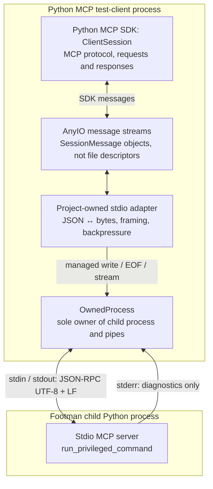

# privileged-test-dispatch Specification

## Purpose

Execute an operator-configured command as a privileged container user against a fixed staged source snapshot through stdio MCP, with attributable retained results.

## Requirements

### Requirement: Operator configuration
The dispatcher SHALL validate versioned configuration once at startup, immutable until restart. It SHALL define repository, launch argv template, required `image_id`, user, command argv, snapshot destination, cwd, snapshot storage, output template and positive bounded `timeout_seconds`/`cleanup_grace_seconds`. Static field, value and path errors SHALL prevent startup. Requests SHALL NOT override command or environment. TOML edits SHALL take effect only after restart.

#### Scenario: Invalid configuration
- **WHEN** configuration contains an empty command, unknown field or working directory outside the snapshot
- **THEN** the server exits nonzero before serving any request, reports the validation error on stderr, and creates no run output directory or snapshot and starts no container or configured command

#### Scenario: Missing configuration file
- **WHEN** the server starts with a configuration path that does not exist
- **THEN** it exits nonzero with empty stdout and a nonempty stderr diagnostic identifying the configuration-load failure, without serving requests or creating run resources

#### Scenario: Runtime-only validation failure
- **WHEN** valid startup configuration later encounters an output/snapshot reservation collision, a disappeared path, a failed container identity/running-state check or failed snapshot transfer
- **THEN** the affected request fails with an unsuccessful tool result and applicable cleanup, rather than being treated as a startup configuration error

#### Scenario: Configured command
- **WHEN** the server starts with a valid configured executable and argument array, such as Cargo, a Gradle wrapper or npm
- **THEN** requests execute that argv without tool-specific restrictions or argument rewriting

#### Scenario: Configuration edited after startup
- **WHEN** the TOML file changes after successful server startup
- **THEN** later requests use the original validated configuration and effective identity without reloading the file

#### Scenario: Configuration applied after restart
- **WHEN** the server restarts after the TOML file changes
- **THEN** it loads and validates the new file once, uses it if valid, and refuses startup if invalid

### Requirement: Nonempty configured argv elements
`command_argv` and `container_start_argv` SHALL each be a nonempty array of nonempty NUL-free strings. This SHALL apply to every element, not only the executable.

#### Scenario: Empty or NUL-containing argv element
- **WHEN** any element of `command_argv` or `container_start_argv` is an empty string or contains NUL
- **THEN** startup rejects configuration with a diagnostic before serving requests or creating run output, snapshots, containers or configured-command side effects

#### Scenario: Empty option value in a nonempty argument
- **WHEN** an otherwise valid launch template includes an equals-form option such as `--name=`
- **THEN** the empty option value does not violate the nonempty-argument requirement because the whole argv element is nonempty

### Requirement: Launch image configuration
`image_id` SHALL be a required string matching either `sha256:[0-9A-Fa-f]{64}` or `[0-9A-Fa-f]{12,64}` in its entirety. It SHALL contribute to the effective configuration identity. Format validation SHALL NOT imply image existence or trigger image build/pull.

#### Scenario: Invalid launch image configuration
- **WHEN** `image_id` is absent, non-string, malformed, outside the allowed lengths or a tag instead of an image ID
- **THEN** startup exits nonzero with a configuration diagnostic before serving requests or creating run output, snapshots, containers or configured-command side effects

#### Scenario: Valid launch image configuration
- **WHEN** configuration supplies a full prefixed image ID or an unprefixed 12–64-character hexadecimal ID such as `d9e853e87e55`
- **THEN** startup accepts that field and includes it in effective configuration identity, without assuming image existence or building/pulling an image

### Requirement: Image identity operator instructions
Operator documentation SHALL describe obtaining local image IDs through `docker image ls` or a full ID by tag through `docker image inspect`, and updating configuration and restarting Footman after rebuilding the image.

#### Scenario: Obtain and refresh the configured image ID
- **WHEN** an operator prepares or rebuilds an image tagged `footman-sandbox:latest`
- **THEN** instructions show copying the ID column from `docker image ls` or the full output of `docker image inspect --format '{{.Id}}' footman-sandbox:latest` into `image_id`, and restarting Footman to load the updated value

### Requirement: Run identity and timestamp
Each accepted request SHALL generate one UUIDv7 with Python 3.14+ `uuid.uuid7()`. Its epoch-millisecond `UUID.time` SHALL define the fixed UTC `utc_timestamp` and `{utc_datetime}`. `run_id` SHALL encode all 128 bits, most significant digit first, as exactly 26 lowercase Crockford Base32 characters using `0123456789abcdefghjkmnpqrstvwxyz`, with leading zeroes, no separators and no check symbol.

#### Scenario: Shared request time
- **WHEN** a request receives a UUIDv7, including during a stalled or backward-moving system clock
- **THEN** its timestamp and output timestamp derive from that UUID's millisecond time, without a second clock read or replacement UUID

#### Scenario: Canonical identity serialization
- **WHEN** a run ID is serialized and decoded
- **THEN** it is 26 lowercase ASCII characters with first digit between `0` and `7`, and decoding recovers the original 128-bit UUID, version, variant and timestamp

### Requirement: Exclusive snapshot reservation
Each snapshot path SHALL be `<canonical snapshot_directory>/<run_id>`, confined under that root and created exclusively before capture. Existing destinations, symlinks and concurrent reservation collisions SHALL fail visibly without reuse, ID regeneration or renaming. A request that failed reservation SHALL NOT modify or delete that destination.

#### Scenario: Snapshot collision
- **WHEN** two requests attempt to reserve the same snapshot path
- **THEN** only one acquires ownership; the other fails before capture or launch without changing or cleaning the winner's directory

#### Scenario: Snapshot root escape
- **WHEN** path resolution or a symlink replacement would put the destination outside the canonical snapshot root
- **THEN** reservation fails without exporting source or launching a container

### Requirement: Fixed staged snapshot
Each request SHALL capture one complete Git index tree and export only that tree. Staged additions, changes and deletions SHALL be included; unstaged and untracked content SHALL be excluded. The development index, files, HEAD and branches SHALL remain unchanged. No commit or patch application SHALL be required.

#### Scenario: Partially staged source
- **WHEN** a file has staged content and additional workdir edits
- **THEN** only its staged version is executed and the result identifies the captured tree

#### Scenario: Concurrent staging
- **WHEN** the index changes after capture
- **THEN** the run continues using the captured tree rather than rereading current source state

#### Scenario: Unresolved index
- **WHEN** the index contains unresolved entries or capture fails
- **THEN** the configured command is not executed and the caller receives a dispatch failure

### Requirement: Isolated source export
The dispatcher SHALL use a fresh source directory without development Git metadata, source mounts or ignored build output. Export SHALL preserve staged blob content and executable modes without executing host-side Git hooks or filters. Unsupported gitlinks, unsafe paths and escaping symlinks SHALL fail explicitly.

#### Scenario: Development build artifacts
- **WHEN** the development directory contains ignored dependencies or compiled executables
- **THEN** they are not copied into the source snapshot as inputs

#### Scenario: Checkout filter
- **WHEN** repository configuration defines a checkout filter
- **THEN** export does not execute it and retains the staged blob bytes

### Requirement: Git entry mode preservation
Export SHALL create exact-byte regular files for modes `100644`/`100755`, directories for tree mode `040000`, and actual symlinks for mode `120000` using blob bytes as targets. Symlink targets SHALL remain inside the snapshot after chain resolution. Absolute/outward targets, cycles, unprovable containment, unsupported modes and `160000` gitlinks SHALL be rejected. Export writes SHALL NOT follow exported links; Git tree modes SHALL NOT be treated as stored directory permissions.

#### Scenario: Internal symlink export
- **WHEN** a staged `120000` entry refers to a target inside the snapshot
- **THEN** export creates a symlink with the blob's target bytes rather than a regular file containing those bytes

#### Scenario: Unsafe symlink chain
- **WHEN** a link chain escapes the snapshot or containment cannot be established
- **THEN** export fails before container launch without writing through that link

### Requirement: Parameterized container launch
The dispatcher SHALL launch a new dedicated container by replacing only the validated image operand with the configured image ID. Docker SHALL resolve the literal operand locally at launch under its name/ID semantics with `--pull=never`, without implicit pulling or a separate pull fallback. Substitution SHALL NOT use shell evaluation, word splitting or recursion.

#### Scenario: Fixed launch image
- **WHEN** a request launches a container after the operator retargets the image's original tag
- **THEN** launch argv still uses the configured `image_id` literally, with abbreviated-ID resolution performed by Docker

#### Scenario: Unresolved launch image
- **WHEN** Docker returns a resolution error for the configured operand
- **THEN** mandatory `--pull=never` prevents pulling even if the hexadecimal operand is interpreted as an image name; the dispatcher retains the literal operand, Docker's status and diagnostics, returns failure without pull fallback, and does not inspect, copy or execute the configured command

### Requirement: Local image resolution limitation
Footman SHALL guarantee literal operand substitution and disabled pulling, not ID-only Docker resolution or failure for every absent ID. Image inspection SHALL remain diagnostic for image identity, without an equality gate. Operator documentation SHALL explain that local hexadecimal-name tags may resolve instead of intended IDs and assign avoidance of conflicting local names to the operator.

#### Scenario: Local hexadecimal-name collision
- **WHEN** the configured operand is `d9e853e87e55` and Docker successfully resolves a local `d9e853e87e55:latest` tag to another image, including when the intended ID is absent
- **THEN** Footman preserves the literal operand and never-pull policy, records the observed image identity separately, and does not reject dispatch solely for that image mismatch; container identity/running-state and copy/execution checks still apply

### Requirement: Constrained launch template
Startup SHALL validate `docker run --detach=true --pull=never [OPTION ...] -- {image_id} [COMMAND_ARG ...]` under design §1. Options SHALL be `--name=value`, split at the first `=`, with nonempty names and no further `detach` or `pull`. The sole placeholder SHALL be standalone `{image_id}` at the image operand immediately after the delimiter. Command arguments SHALL be literal and placeholder-free. Invalid shapes/placeholders SHALL fail before run-resource acquisition.

#### Scenario: Constrained image operand
- **WHEN** launch argv is `docker run --detach=true --pull=never --privileged=true -- {image_id} sleep infinity`
- **THEN** startup accepts its shape and launch replaces exactly the image operand with the configured ID, leaving options and command arguments unchanged

#### Scenario: Missing or conflicting pull policy
- **WHEN** a template omits the fixed `--pull=never` prefix element, replaces it with `--pull=always` or `--pull=missing`, or adds another pull option (including another `--pull=never`)
- **THEN** startup rejects it with a diagnostic and no run-resource side effects

#### Scenario: Invalid launch shape
- **WHEN** launch argv uses a wrapper, alternate executable, Docker global options, short/bare flags, separate option values, an additional detach option, a missing options delimiter or an unrelated image before `{image_id}`
- **THEN** startup fails with a validation diagnostic before serving requests or creating run output, snapshots, containers or configured-command processes

#### Scenario: Invalid launch placeholder
- **WHEN** launch argv omits `{image_id}`, repeats or embeds it, places it anywhere except the image operand, or contains an unknown placeholder, including any `{snapshot_path}` occurrence even alongside `{image_id}`
- **THEN** startup rejects configuration before creating run resources

#### Scenario: Launch arguments
- **WHEN** a validated template is expanded for a request
- **THEN** configured `image_id` is substituted literally and the launch argv does not receive the host snapshot path

### Requirement: Staged snapshot container copy
After launch and container identity/running-state inspection, the dispatcher SHALL copy the complete exported staged snapshot contents into `container_snapshot_directory` of that exact container before exec. Transfer SHALL preserve exact bytes, executable modes and actual internal symlinks without dereferencing them. It SHALL NOT transfer the workdir, `.git` or unstaged/untracked/ignored inputs. It SHALL NOT add an enclosing run-ID directory.

#### Scenario: Staged bytes copied
- **WHEN** a staged file differs from later workdir edits
- **THEN** the container receives its staged bytes at the configured snapshot destination, with the host snapshot and development state unchanged

#### Scenario: Snapshot copy path characters
- **WHEN** absolute host source or container destination paths contain spaces, colons or newlines
- **THEN** startup/per-request validation accepts those characters and literal copy argv preserves each path as one argument

#### Scenario: Invalid copy source or destination
- **WHEN** a path contains NUL, is non-absolute, or the host source's canonical identity cannot be resolved/validated under snapshot ownership
- **THEN** validation fails with the specific cause; later filesystem/Docker errors retain their actual diagnostics

### Requirement: Fresh copy destination and transfer failure
The dispatcher SHALL run literal `docker exec -u root <id> mkdir -- <destination>`, then, only on success, `docker cp <host-snapshot>/. <id>:<destination>/`. Existing destination, missing parent or failed/partial copy SHALL prevent command execution and retain the ID for cleanup without retry. Preparation/copy argv, status and diagnostics SHALL form infrastructure-summary records in `result.json`.

#### Scenario: Missing parent or preexisting destination
- **WHEN** the destination's parent is missing or the destination already exists
- **THEN** `mkdir` fails, snapshot copying and the configured command do not start, and dispatch reports failure with applicable container cleanup

#### Scenario: Partial snapshot transfer
- **WHEN** copying fails after creating some container files
- **THEN** the configured command does not run, transfer failure is reported separately, and the attributable container remains subject to cleanup

### Requirement: Container copy prerequisites
The image SHALL provide `mkdir` supporting `--`. The operator SHALL provide an existing destination parent with directory-only, symlink-free ancestors and keep that path stable during preparation/copy. Footman SHALL create only the final directory using `mkdir` without `-p`. Operator documentation and the annotated TOML SHALL state these prerequisites; in-container path stability is an operator responsibility.

#### Scenario: Prepared destination parent
- **WHEN** `container_snapshot_directory` is `/workspace/source`
- **THEN** the image or operator-controlled startup supplies `/workspace` before copying, `/workspace/source` is initially absent, and Footman creates `source` before copying the snapshot contents

### Requirement: Copied source permissions
Operator documentation and the annotated TOML SHALL explain root-owned destination creation and ordinary `docker cp` container-root ownership. The operator SHALL arrange traversal/read/execute access and command-required write permissions for a non-root configured user. Footman SHALL preserve the configured identity and report access failures through the applicable operation status.

#### Scenario: Non-root configured execution
- **WHEN** the operator configures a non-root user
- **THEN** instructions explain the required permissions for the copied tree and any operator-supplied permission step, without assuming root ownership alone prohibits execution or automatically provisioning ownership

### Requirement: Container launch output contract
Startup SHALL exit zero and return only one full Docker container ID on stdout, optionally followed by one newline; diagnostics SHALL go to stderr. The ID SHALL identify the new dedicated container. Nonzero exit, malformed output or a container not running SHALL prevent configured-command execution. Startup output and status SHALL be retained separately.

#### Scenario: Valid launch
- **WHEN** startup exits zero with one valid container ID and inspection confirms the exact returned container ID and its running state
- **THEN** subsequent execution uses exactly that ID

#### Scenario: Invalid launch result
- **WHEN** startup exits nonzero or stdout contains no ID, extra text or multiple IDs
- **THEN** the configured command does not run and startup diagnostics/status are retained as dispatch failure

### Requirement: Container inspection and image attribution
Before copying or exec, inspection SHALL confirm the exact returned container ID and its running state. Configured `image_id` and the full observed `Image` ID (`sha256:` plus 64 hexadecimal characters) from container inspection SHALL be recorded separately for attribution. Unavailable or unusable observed identity SHALL be recorded as unknown with a diagnostic. Image selection SHALL rely on literal `{image_id}` launch substitution.

#### Scenario: Observed image attribution
- **WHEN** inspection confirms the exact running container
- **THEN** the result records configured `image_id`, including an abbreviated value, and the full observed `Image` ID separately, using unknown with a diagnostic for unavailable or unusable observed identity

#### Scenario: Invalid container inspection
- **WHEN** inspection fails, identifies a different container ID or reports a non-running container
- **THEN** copying and configured-command execution do not start, dispatch fails, and the recorded launch container ID remains available for applicable cleanup without retry or automatic configuration update

### Requirement: Launch inspection protocol
The dispatcher SHALL run one literal `docker container inspect --format {{.Id}}|{{.State.Status}}|{{.Image}} <id>` for launch validation, with the format as one argv element, closed stdin and the remaining request deadline. It SHALL record argv/status, bounded stdout/stderr excerpts and parse diagnostics in the `result.json` infrastructure summary. Container validation and image attribution SHALL share that result.

#### Scenario: Inspection record parsing
- **WHEN** inspect exits zero with one record and at most one trailing LF
- **THEN** its first two pipe-delimited fields must be a full 64-hex ID equal to the returned launch ID (hex case insignificant) and status exactly `running`; the optional remainder is full `sha256:<64 hex>` image metadata or unknown with a diagnostic if absent/empty/malformed

#### Scenario: Invalid mandatory inspection data
- **WHEN** inspect exits nonzero, returns multiple records, omits/unparseably encodes ID or status, identifies a different container or reports a non-running state
- **THEN** dispatch fails before mkdir/copy/command execution and retains diagnostics and the recorded launch ID for applicable cleanup

### Requirement: Configured container execution
The dispatcher SHALL execute configured command argv in the newly launched container as the configured user from the in-container cwd `{container_snapshot_directory}/{working_directory}`, normalized and confined below the configured snapshot destination. The dispatcher SHALL NOT substitute the host snapshot path into exec argv. It SHALL use literal argv, closed stdin and no TTY. It SHALL NOT infer test organization, add filters or provision project-specific identities.

#### Scenario: Configured execution
- **WHEN** launch validation and snapshot copying succeed
- **THEN** execution uses the returned container ID, configured user, copied staged snapshot and exact command argv

#### Scenario: Container working directory
- **WHEN** the snapshot destination is `/workspace` and the configured relative working directory is `subdir`
- **THEN** execution uses `/workspace/subdir`, not the host snapshot path; `.` uses `/workspace`

#### Scenario: Missing execution prerequisite
- **WHEN** the container, user, working directory or executable is unavailable
- **THEN** the run reports an execution/dispatch failure rather than a successful command

### Requirement: MCP-only dispatch interface
The dispatcher SHALL run as a stdio MCP server invoked as `footman --config <config.toml>`. It SHALL expose `run_privileged_command` accepting only an optional string `phase` label. Configuration selection SHALL be operator-controlled. MCP stdout SHALL contain only protocol messages, and agents SHALL receive no Docker socket, direct command-execution CLI or general-purpose host command interface.

#### Scenario: Unexpected tool argument
- **WHEN** an MCP client supplies command arguments, paths or any field other than `phase`
- **THEN** the tool rejects the request before snapshot capture or container execution

#### Scenario: Server startup
- **WHEN** an operator starts the dispatcher with a valid configuration path
- **THEN** it serves `run_privileged_command` over stdio using that fixed configuration

### Requirement: Owned child stdin foundation
`OwnedProcess` SHALL provide explicit opt-in child stdin with coordinator-mediated binary writes and EOF, bounded buffering and deadline/cancellation-aware progress. The coordinator SHALL retain sole lifecycle authority over the pipe. This generic process foundation SHALL NOT depend on MCP or contain SDK/transport policy. The stdin foundation SHALL have independent tests, lifecycle documentation and ownership verification without requiring MCP.

#### Scenario: Opt-in writable child stdin
- **WHEN** a caller launches a child with writable stdin explicitly enabled
- **THEN** the parent write endpoint has exactly one prepared foundation owner (OwnedStream for Popen.stdin, or OwnedDescriptor for a manually acquired raw fd with only closefd=False wrappers), coordinator-mediated binary writes are bounded and deadline/cancellation-aware, explicit EOF is supported, and stdout/stderr retain their existing single collection and ownership

#### Scenario: Dedicated opt-in stdin API
- **WHEN** a caller requests writable stdin
- **THEN** it uses the dedicated launch stdin_mode keyword with "pipe", defaulting to "closed" otherwise; write_stdin accepts bytes and a finite positive timeout_seconds, close_stdin coordinates EOF, and no raw stream/fd or popen_kwargs stdin override is permitted

#### Scenario: Write completion and partial progress
- **WHEN** write_stdin succeeds
- **THEN** it returns len(data), counting bytes successfully written to the OS pipe, not child consumption; short OS writes are completed internally against one deadline and success never returns a partial count
- **WHEN** an attempted write times out, encounters EPIPE or otherwise fails ordinarily
- **THEN** StdinWriteError exposes accepted_bytes for the exact OS-written prefix, the original cause and timed_out; the channel rejects further writes without automatic payload/suffix replay, even if no bytes were accepted
- **WHEN** a process-control interruption occurs during writing
- **THEN** its original identity/authority is preserved without wrapping or mutation, its exact OS-accepted progress is available through the calling thread's OwnedProcess.stdin_write_observation(), and the channel rejects further writes

#### Scenario: Public interruption progress observation
- **WHEN** the caller reads OwnedProcess.stdin_write_observation()
- **THEN** it receives None before any attempted write on that owner/thread, otherwise the immutable StdinWriteObservation for that calling thread's last finished attempted write, with requested_bytes: int, accepted_bytes: int, outcome: completed/failed/interrupted, error: BaseException or None and timed_out: bool; values are not cumulative or a global last-call slot
- **WHEN** a write returns or raises, including KeyboardInterrupt after partial progress
- **THEN** the observation is recorded first, retains exact progress and original failure/interruption identity, successful writes have full acceptance/error=None/timed_out=False, invalid argument/state rejections leave the prior record unchanged, and concurrent callers, repeated reads and EOF/cleanup cannot mutate handed-out snapshots or replace another thread's record; final-cleanup store retirement follows the separate lifetime contract

#### Scenario: Observation thread identity and retention
- **WHEN** observations are keyed, published, read or cleaned up
- **THEN** weak actual Thread-object identity is used instead of numeric thread ids; terminated-thread records are pruned even when Thread objects remain externally referenced, and at most one record per live contributing thread is retained rather than an ever-seen-thread history
- **WHEN** a new thread has the same numeric ident as a terminated writer
- **THEN** it first observes None, whereas reuse of the same live worker legitimately observes its own previous call; deterministic identity-reuse controls and real thread-lifetime tests verify the distinction

#### Scenario: Observation lifecycle reads and retirement
- **WHEN** stdin_write_observation is read in closed mode
- **THEN** it returns None without StdinStateError
- **WHEN** reap or shutdown initiation is observed, or cleanup is pending/read through cleanup_status
- **THEN** the calling thread's last record or None remains readable without new resources or observation retirement
- **WHEN** explicit shutdown or wait_cleanup completes final cleanup after write/EOF calls quiesce and publish
- **THEN** the owner-side store is cleared and permanently retired, further reads return None without resurrection, and previously returned immutable snapshots and independent lifecycle failures remain valid

#### Scenario: Progress accounting is not a duplicate ledger
- **WHEN** the public lifecycle contract describes StdinWriteObservation
- **THEN** docs/process-lifecycle.md explicitly permits it in the immutability/exclusions paragraph for OS-acceptance accounting, not as a second lifecycle ledger, callback store or exception-attached snapshot
- **WHEN** one ordinary write failure is exposed through its wrapper, progress record and lifecycle ledger
- **THEN** wrapper.cause is observation.error is matching_ledger_failure.error, retaining the same original exception without copying/mutation and keeping independent cleanup failures separate

#### Scenario: Public stdin exception contract
- **WHEN** stdin APIs expose ordinary write errors
- **THEN** StdinWriteError directly subclasses Exception and declares read-only accepted_bytes: int, cause: Exception and timed_out: bool without modifying the cause; cause is distinct from __cause__ and wrapper raises explicitly chain from it
- **WHEN** public exports and failure classification are checked
- **THEN** StdinWriteObservation, StdinWriteError, StdinStateError (RuntimeError) and StdinCloseTimeout (TimeoutError) are exported through footman.process.__all__ alongside all existing names; expected stdin failures are explicitly ORDINARY, unexpected failures retain their classification and process-control exceptions remain unwrapped interruptions

#### Scenario: Direct bounded writes
- **WHEN** callers concurrently write stdin
- **THEN** the coordinator serializes direct nonblocking writes on caller threads, includes gate/readiness waiting in each timeout, holds no general lifecycle lock across waiting/I/O, adds no writer worker or pending-payload queue, and limits each OS write to a 65536-byte view without copying a backlog

#### Scenario: Write and EOF call states
- **WHEN** either operation is called in default closed mode, or write is called after EOF request, channel failure, shutdown initiation or observed reap
- **THEN** StdinStateError rejects the call without resource acquisition, lazy pipe creation or DEVNULL writing; empty writes are subject to the same state check and return 0 only while writable
- **WHEN** close_stdin is called with a finite positive timeout_seconds
- **THEN** it marks EOF requested, prevents new writes and waits only within that bound for active write serialization and the sole close; successful completion returns None without claiming child consumption/exit, and repeated successful close returns None without another release
- **WHEN** close waiting times out or an actual close fails
- **THEN** StdinCloseTimeout or the retained close failure is observable, pending EOF keeps the same owner/continuation without closing beneath active work, and repeat close only observes pending/success/failure without renewed allowance or repeated close; shutdown/reap permits only observation of the existing EOF/release state

#### Scenario: Validation boundaries
- **WHEN** launch receives an unsupported or non-string stdin_mode, including a boolean
- **THEN** it rejects it before acquisition, factory invocation or worker creation without leaving resources behind
- **WHEN** write_stdin or close_stdin receives a nonnumeric, boolean, nonfinite or nonpositive timeout_seconds
- **THEN** TypeError rejects invalid types including bool and ValueError rejects nonfinite/nonpositive numeric values before writing or acquiring additional resources without altering the existing process or its owners/state; non-bytes write data also raises TypeError

#### Scenario: Endpoint handoff and observable EOF
- **WHEN** stdin is acquired and handed to the child
- **THEN** each caller-acquired endpoint has exactly one owner and partial setup releases every independent resource once; manual pipe creation, if used, accounts for both raw descriptors and releases the parent read endpoint after handoff or launch failure
- **WHEN** close_stdin completes and a generic child reads until EOF
- **THEN** the child observes EOF within the tested bound without a parent-owned duplicate write endpoint keeping the pipe open

#### Scenario: Output-only stream identity and stdin failures
- **WHEN** writable stdin is enabled
- **THEN** ProcessStream remains exactly STDOUT/STDERR, stream_outcomes and chunk/end callbacks remain output-only and stdout/stderr retain one collection
- **WHEN** stdin setup, write/EOF coordination or owner close fails
- **THEN** FailureInfo retains the original exception and kind with stream=None and respectively SETUP, COORDINATION or RELEASE phase; release diagnostics identify owner stdin without changing the public FailureInfo shape
- **WHEN** stdin close alone fails or follows an active operation/interruption
- **THEN** cleanup_status/wait_cleanup retain the close failure even after settlement, preserve active failure/interruption precedence and stable repeated observations, and do not rely on the output-callback-only reporter for delivery

#### Scenario: Missing or aliased stdin
- **WHEN** pipe mode receives missing/None stdin, stdin identical to stdout/stderr, or partial child-end handoff failure
- **THEN** setup fails closed without silent closed-stdin fallback, every acquired resource has one release authority, independent cleanup proceeds and aliases are not released twice
- **WHEN** raw pipe descriptors are manually adopted
- **THEN** same-fd double adoption is rejected while distinct descriptors for opposite pipe ends remain valid

#### Scenario: Explicit EOF before shutdown
- **WHEN** a caller needs graceful child exit driven by stdin EOF
- **THEN** it explicitly calls close_stdin before shutdown, delivering EOF while the child may still run without waiting for reap; shutdown retains its StopPolicy behavior rather than implicitly providing a graceful stdin protocol, and subsequent cleanup does not repeat release

#### Scenario: Closed stdin regression
- **WHEN** Git/Docker helpers or a default `OwnedProcess.launch` are started
- **THEN** stdin remains closed rather than inheriting an interactive stream or acquiring a writable pipe implicitly

#### Scenario: Backpressure or peer closes stdin
- **WHEN** the child stops reading or closes its input during a write
- **THEN** writes do not block shutdown indefinitely, partial writes/broken pipes remain observable, and applicable independent cleanup preserves operation/interruption authority without duplicate release or renewed cleanup budgets

#### Scenario: Concurrent EOF and cleanup
- **WHEN** writes, explicit EOF, cancellation or repeated/concurrent cleanup overlap
- **THEN** the coordinator serializes the handoff, does not close beneath active pipe work, attempts each independent release exactly once, reports sole-close failures, and retains the same owner/continuation for incomplete cleanup

### Requirement: Owned test-client stdio transport
Executable protocol verification SHALL use the real SDK `ClientSession` over a project-owned stdio transport backed by `OwnedProcess.launch` and validated stdin. The coordinator SHALL retain sole child/pipe lifecycle authority; SDK `stdio_client`, independent child control and in-memory-only substitutes SHALL NOT be used.

#### Scenario: Test-only client transport boundary

The following diagram illustrates the test-client stdio transport and its ownership/protocol boundaries. This is test infrastructure using the real Python MCP SDK, not a production client component required to use Footman; production clients use their own transports. It adds no public client interface:

- **WHEN** the test client connects to the executable
- **THEN** the components follow the diagram's ownership boundaries without making the test-client transport a production prerequisite

#### Scenario: Isolated host test support
- **WHEN** host acceptance copies test support into its external workspace
- **THEN** it includes tests/mcp_transport.py and its declared transitive support closure alongside tests/__init__.py and tests/green_skip_policy.py, attributes all copied files through source/support identity checks, and uses the installed wheel's OwnedProcess without checkout imports or an alternate subprocess owner

#### Scenario: Test transport consumes the pinned stdin contract
- **WHEN** the test transport sends frames and requests EOF
- **THEN** it launches stdin_mode="pipe", calls write_stdin(frame_bytes, timeout_seconds=remaining) and requires the full frame-length result, retains StdinWriteError.accepted_bytes/cause/timed_out without replay, and calls close_stdin(timeout_seconds=remaining), distinguishing confirmed EOF from pending/failure without redefining the foundation API

#### Scenario: Test transport interruption observation
- **WHEN** the write bridge receives a process-control interruption
- **THEN** it reads stdin_write_observation() on the write's own calling thread and hands that immutable record to the async side before another write on that worker/owner or final-cleanup retirement, preserving exception identity and exact accepted-byte attribution without exception mutation or a cross-thread last-call lookup

#### Scenario: Attributed server process
- **WHEN** development or isolated-wheel tests launch the server
- **THEN** they use the explicit absolute interpreter and tests/mcp_server_child.py bootstrap argv defined in the design, dispatching the public module in development or the exact installed venv console script for wheel/host verification in the same child, never a PATH-resolved ambient footman or another subprocess
- **WHEN** the bootstrap validates service provenance before serving requests
- **THEN** canonical Footman-package source paths and file digests, including required footman/startup/process/__main__ entries, match the intended checked checkout or installed wheel, installed-script identity is checked where applicable, explicit child environments exclude inherited import redirection, and missing/mismatched provenance fails without production API additions or stdout metadata; checking only parent imports is insufficient

#### Scenario: Canonical lifecycle argv variants
- **WHEN** ordinary direct development, isolated exact-wheel or real-host acceptance dispatching legs launch the service
- **THEN** the canonical argv omits --lifecycle; the wheel form is `[venv_python, "-P", copied_tests_mcp_server_child, "--expected-origin", expected_manifest, "--entrypoint", absolute_venv_footman_script, "--", "--config", absolute_config]`
- **WHEN** nested relocated acceptance launches the service
- **THEN** it requires the wheel form with exactly `--lifecycle <absolute_lifecycle_input>` inserted immediately before --; omission, duplication, wrong placement, use in ordinary direct dispatching legs or forwarding to production fails exact-argv controls; Phase-9 bootstrap lifecycle contract tests explicitly require the lifecycle-enabled wheel variant, including non-dispatching validation/publication-fault launches using Phase-9-owned disposable wheel/install fixtures without future Phase-10 dependencies
- **WHEN** the production entrypoint receives --lifecycle or another unknown option
- **THEN** it rejects the option without dispatch or a public lifecycle capability; --lifecycle is the bootstrap's only lifecycle-specific option, not a production startup flag

#### Scenario: Phase-9-owned isolated-wheel contracts
- **WHEN** Phase 9 records RED and delivers its bootstrap/protocol contracts
- **THEN** tests/mcp_wheel_support.py::build_and_install_contract_wheel owns a bare uv build from a recorded matching-input disposable repository root, successful output-path/independent SHA-256/input-stability binding, fresh external venv/noneditable exact-wheel install, archive-derived context="wheel" expectations and declared support copying, independently of future Phase-10 code
- **WHEN** the registered Phase-9 suite runs
- **THEN** real initialization/tool discovery is required in both development and isolated-wheel contexts, alongside both canonical wheel argv variants, lifecycle-validation/journal faults, installer-generated launcher semantics and all build/archive/install/copy lifecycle fault branches; missing prerequisites fail nonzero without skip/xfail
- **WHEN** Phase 9 validates and later build paths are introduced
- **THEN** its summary cites executed build/binding/install/archive/launcher/lifecycle and both-context protocol nodes; inert tests/wheel_attribution_cases.py supplies common attribution cases to Phase-9, Phase-10 and Phase-11 tests, preserving independent implementations and the same bare-build/output ownership contract without claiming the Phase-9 fixture establishes relocated-helper portability

#### Scenario: Deterministic independent attribution cases
- **WHEN** shared attribution cases exercise the three independent build paths
- **THEN** inert case records prepare matching-input disposable repositories, pre-existing/artifact identities and explicit PATH-selected scripted uv status/stdout/stderr/artifact/input-mutation behavior, asserting exactly bare uv build and recording command/cwd/PATH/resolved-stub identity/status/full output or preflight not-attempted
- **WHEN** a public surface is driven
- **THEN** tests call Phase-9 build_and_install_contract_wheel(attribution_only=True), Phase-10 build_and_bind_wheel, or invoke the Phase-11 scripts/build-acceptance-wheel shell wrapper as an OwnedProcess subprocess with recorded bootstrap PYTHONPATH replacement, without production imports from tests/ or calls to private helper internals
- **WHEN** the Phase-9 attribution-only branch succeeds or fails
- **THEN** it shares the default real flow's attribution steps but returns or fails before any venv/dependency/install acquisition; all scripted artifacts/manifests remain attribution-only, never install inputs or substitutes for each leg's real-uv-built independently SHA-256-bound wheel
- **WHEN** case observations are compared
- **THEN** the driver normalizes accepted/rejected attribution, attempt/status/argv/cwd, selected path/digest, input identities and rejection category with public exception/exit/manifest observations, preserving complete outputs, underlying statuses and cleanup failures without requiring identical implementation classes
- **WHEN** Phase-10 cases are introduced
- **THEN** 10.2 authors/records their RED or explicit expected-path/digest/status negative controls before 10.4 closes them, without breaking production behavior, and 10.5 cites those nodes as first-owned Phase-10 coverage

#### Scenario: Attribution-case per-leg input profiles
- **WHEN** a shared scripted attribution case is prepared
- **THEN** its inert record declares case_id, shared build/status/artifact/mutation expectations and explicit per-leg inventories; Phase-9/10 input trees contain exactly src/, pyproject.toml and README.md with dist state separately recorded, assert identity-only roots/.git are absent and emit no production manifest, without narrowing real build/install fixtures
- **WHEN** the Phase-11 profile is prepared
- **THEN** it includes common build bytes plus the complete src/, tests/, host_tests/, scripts/, pyproject.toml and uv.lock identity scope and required wrapper dependencies, a case-owned host_tests marker and a recorded resolvable synthetic Git HEAD assembled without staging; README.md is outside that six-root source identity scope but required in the separate build_input_identity, and relocation preserves revision and both content identities independently of absolute paths
- **WHEN** drivers record and compare observations
- **THEN** each validates its inventory and records scoped pre/post identity plus synthetic/candidate revision distinctions, comparing shared case_id/common bytes/outcomes and within-scope stable/changed relations rather than demanding equal digests across different profiles
- **WHEN** required inputs, revision or wrapper dependencies are missing, extra or invalid
- **THEN** verification reports a fixture/setup error rather than expected attribution rejection, and no driver silently supplies undeclared files to make a case pass

#### Scenario: Single-command host verification by local image tag
- **WHEN** an operator manually invokes `/home/aavasiljev/work/home/footman.git/scripts/verify_host_acceptance.py <local-image-tag>` on the host from any cwd
- **THEN** it is a single executable Python file with exact shebang `#!/usr/bin/env python3.14` and no shell wrapper, derives root from physically resolved __file__ independently of caller cwd, uses PATH python3.14 (missing interpreter: env diagnostic/127 before script execution), checks uv prerequisites, fails closed on invalid checkout-foundation imports and cleans installed-child import environments, resolves the tag once with local Docker image inspection without build/pull, records the tag/full ID and passes only that ID to the unchanged ID-only runner interface
- **WHEN** orchestration executes the host verification
- **THEN** it derives project root from its physically resolved script location, not caller cwd, reserves and prints a fresh exclusive per-run directory under the hardcoded `/tmp/gorshochek/ephemeral/footman.git/host-acceptance` base (no results-dir argument/environment override), invokes the controlled build helper, validates that successful manifest's exact wheel binding without dist scanning, and executes four isolated real-host negative expectation controls (staged bytes, argv, command status and cleanup observations) followed by a separate normal host suite against that wheel
- **WHEN** a negative control is assessed
- **THEN** its actual nonzero status and complete output are retained and only its intended assertion mismatch with reconciled resources counts as detection; prerequisite/setup/unrelated failures do not count, expectations change only in isolated fixtures, and no production code/configuration capability or developer source/index mutation is introduced
- **WHEN** orchestration completes or fails
- **THEN** it preserves actual per-leg statuses and the first unexpected failing status, attempts independent cleanup/evidence finalization and independent legs with valid prerequisites, and returns zero only after every targeted negative detection, normal suite, evidence retention and resource reconciliation succeeds; normal tests have no skips/xfails/xpasses/exclusions, expected-negative nonzero statuses are labeled separately, and failed builds never feed installs
- **WHEN** existing predicted build outputs prevent a rerun
- **THEN** the script preserves them and reports exact conflicts with the existing explicit operator-removal/clean-matching-root remedies, without implicit deletion/replacement/reuse or selecting a build root through caller cwd; each invocation retains separate evidence

#### Scenario: Isolated host assertion closure and negative-control inputs
- **WHEN** normal or negative host workspaces are prepared
- **THEN** they explicitly copy `tests/host_acceptance_assertions.py` and its declared dependencies alongside transport/bootstrap support, import those copied assertions without checkout fallback and include that closure in source/support inventories and post-copy/completion identity rechecks
- **WHEN** a negative expectation leg executes
- **THEN** copied host conftest validates fixed-path `host_tests/expectation_input.json` with exactly schema_version=1, one of staged_bytes/argv/command_status/cleanup as case_id and a case-typed expected_override before acquisition, and an internal-only prepared-leg Python execution function invokes the explicit copied `host_tests/test_negative_expectations.py` path through shared runner owners/provenance/evidence handling; no new production/public-runner CLI/env switch or arbitrary command override exists
- **WHEN** the orchestrator executes the normal leg
- **THEN** it uses the same validated in-process `_execute_prepared_leg` → `_load_host_runner` → `_execute_prepared_host_leg` route as negative legs, with the complete normal profile and typed wheel/manifest/image/evidence inputs, not a wrapper subprocess or CLI-main call; it records structured function outcomes separately from actual child argv/cwd/full separate outputs/raw statuses/cleanup, preserves per-leg state and exception/interruption precedence, restores unavoidable temporary globals and constructs clean child environments with sole-owned processes
- **WHEN** public runner wrapper behavior is verified
- **THEN** separate dedicated Docker-free subprocess contracts genuinely execute the four-option shell-wrapper CLI through OwnedProcess, check resolved-root/bootstrap/environment/provenance/policy and missing python3.14/uv diagnostic/127 behavior with full output/status evidence, and do not replace those checks with in-process success or count prerequisites as negative detections/passing legs
- **WHEN** the normal public runner executes
- **THEN** it runs the complete normal suite from its normal copy profile, without the negative-suite module or JSON input, rejects unexpected override input and never filters normal required items to select a negative leg
- **WHEN** the single-file orchestrator bootstraps checkout foundation imports
- **THEN** before any footman.* import it validates and inserts exactly its physically resolved root/src as the sole added sys.path import root, records bootstrap_import_root, rejects missing/unsafe/wrong-origin or preloaded ambient Footman without fallback, uses function-scoped foundation imports without E402 suppression, adds no scripts/cwd/second root or self-re-exec, and keeps installed-child environments free of checkout injection
- **WHEN** the orchestrator reaches internal prepared-leg execution
- **THEN** its named `_execute_prepared_leg` boundary lazily calls `_load_host_runner`, which uses stdlib importlib by-path loading of exactly its physically resolved sibling run_host_acceptance.py and calls that module's `_execute_prepared_host_leg`; it validates/records module path, spec origin and source SHA-256 against the checked root inventory after foundation preflight and before build/install/service acquisition, retains sole-owner validation reads and completion identity checks, rejects unsafe/wrong-root targets and import side effects, and reuses that same bootstrap_import_root, rejecting runner-root disagreement before exec_module and adding no scripts package import, loader-side sys.path/PYTHONPATH preparation, second root beyond the single validated orchestrator bootstrap, E402 suppression or CLI/env channel
- **WHEN** Phase-11 orchestration is developed
- **THEN** 11.4 verifies only core/report and recorded build/execution boundaries, monkeypatching the named internal `_execute_prepared_leg` boundary without loading future runner code, while disposable fixtures test loader contracts; 11.10.1 uses the real loader/execution route with delivered helpers, real-uv wheel installs and actual copied fixtures with stub Docker before full GREEN, without loader/execution doubles; this remains simulation, not real-host proof

#### Scenario: Introspection of internal tooling capabilities
- **WHEN** 11.13 reviews the Docker-free candidate
- **THEN** its written audit explicitly verifies `_RESULTS_BASE`, `_execute_prepared_leg` and `_load_host_runner` have no CLI/env/config/public control surface for patching, base selection or loader targets while ordinary CLI internal use remains permitted; checks exactly one validated root/src bootstrap and recorded bootstrap_import_root, loader path/spec origin/source SHA-256 and pre-exec root agreement, no scripts package import/second root/path changes beyond that bootstrap, and no out-of-scope public capability; audits the shared normal/negative internal execution route, per-leg state/failure/interruption/global-restoration and child ownership/environment, separately audits dedicated public wrapper subprocess contracts and prerequisite attribution, and verifies no in-process CLI main

#### Scenario: Results-base test seam and run-directory reconciliation
- **WHEN** Docker-free tests exercise base failures
- **THEN** only a private module-level `_RESULTS_BASE` constant in the loaded orchestrator may be patched for fixture-owned bases, without source rewriting or CLI/env/config/public override; separate unpatched contracts assert the exact production literal `/tmp/gorshochek/ephemeral/footman.git/host-acceptance` and no argument/environment redirection, and direct-executable child invocations retain the unmodified default
- **WHEN** any test leg touches the real base, including positive/normal, negative and integration legs
- **THEN** it records before/after no-follow inventories and exact exclusively created owned run paths, preserves needed test evidence outside cleanup targets and reconciles only those recorded paths through sole owners with matrix-A failure/interruption/repeat/independent-cleanup coverage, proves pre-existing entries unchanged/no undeclared residue and never deletes broadly/by mtime or adopts collision paths; unknown changes, inventory failure or unresolved cleanup fail verification without deletion of unknown resources; patched bases use the same ownership discipline
- **WHEN** the operator manually executes host acceptance
- **THEN** its evidence directories are explicitly retained resources for exact-path handoff/11.16, not test-cleanup residue, and submitting basic host-run results and the exact run path is sufficient implicit shared-mount handoff without a separate explicit operator confirmation; actual file readability is checked by the Agent on resumption, not claimed from local file-access fixtures

#### Scenario: Prepared-root orchestrator contracts and integration
- **WHEN** 11.4 core/loader contracts or 11.10.1 real-helper integration exercise the orchestrator
- **THEN** only a disposable prepared complete-profile copy selects its own root by script location, with declared src/, tests/, host_tests/, scripts/, pyproject.toml, uv.lock, matching README.md bytes, complete available wrapper/foundation dependencies and recorded resolvable synthetic HEAD; 11.4 supplies a case-owned host_tests marker and future-runner loader fixtures/doubles without prematurely changing production roots, whereas 11.10.1 copies delivered real suites/helpers and loads its real sibling runner
- **WHEN** real uv or by-path integration runs
- **THEN** it builds/loads only in that prepared root and records full per-leg inventory, prepared root, synthetic versus candidate revision, both scoped pre/post identities and dist inventories; independent candidate-checkout dist and source/build-input identities must remain unchanged on success and failure, and missing profile roots/dependencies/HEAD are setup errors rather than expected rejections

#### Scenario: Narrow default-base test repair within final acceptance
- **WHEN** task 11.17 repairs the test's total-base-size assumption
- **THEN** the existing direct/default-loaded integration selects only its exact exclusively acquired run path/receipt checked against no-follow before/after inventories, preserves a separately fixture-owned deterministic sentinel and all operator evidence, rejects unknown additions/mutations without deletion, and cleans only recorded test-owned resources through their sole owners with relevant lifecycle fault controls; never use newest/mtime, unchecked deltas or total base size one
- **WHEN** the narrow repair and final validation proceed
- **THEN** this change owns that fix/regression and original 11.17–11.19, without dependency on the follow-up's Admission mutex, shared-UID or dist enhancements or archive; retain existing suite exclusivity and manual dist remedies, require fresh full G and applicable checks, and determine operator host repetition from affected behavior and source/build identity comparisons, including scoped test/support changes, not merely planning edits
- **WHEN** follow-up features have been delivered in the candidate being accepted
- **THEN** their explicit rerun contract supplies the narrow orchestrator-preparation exception to the baseline manual-conflict policy, while the helper and independent fixture collision guards remain unchanged; current affected checks and identities are required, and neither historical success nor moving tasks establishes final acceptance

#### Scenario: Docker-free preparation and manual host handoff
- **WHEN** the Agent prepares Phase 11 inside the development container
- **THEN** it completes Docker-free RED contracts, implementation, fixture/suite authoring, full development GREEN/build/help/install smoke, INTROSPECT and readiness VALIDATE before stopping for the operator; no Agent-run Docker, host-script invocation or remote/background host execution is allowed
- **WHEN** the operator runs the host script and resumes the Agent inside the container
- **THEN** the operator submits basic results including the exact printed run path and actual shell status, without a separate mount-visibility confirmation; the Agent attempts evidence readback and reports inaccessible files as a handoff/evidence issue; the script retains complete outputs, raw per-leg statuses, provenance/build bindings, counts/warnings and resource reconciliation in the shared results directory, with a versioned read-back summary explicitly distinguishing incomplete and final state
- **WHEN** the Agent analyses the exact supplied directory through the container mount
- **THEN** it independently checks report completeness, candidate revision/content and both identities, exact-wheel binding, targeted negative detections, normal-suite policy/results and cleanup, rejects missing/partial/inconsistent/stale evidence and never selects the newest run by mtime or assumes operator execution implies success
- **WHEN** failures or relevant changes require another iteration
- **THEN** the Agent diagnoses them, adds Docker-free RED regressions where possible, fixes and repeats full GREEN, INTROSPECT and VALIDATE before another stop/manual operator host run/container resumption; each attempt uses fresh results and preserves history, affected checks require fresh evidence and unresolved resources block acceptance
- **WHEN** final acceptance is published
- **THEN** both current environment legs and coverage/ownership/resource reconciliation pass with self-contained evidence, operator-only observations remain distinguished from container-verified facts, and independent build wheel digests need not equal; the host leg is the single manual verify_host_acceptance.py run invoking the controlled build helper and shared normal/negative in-process runner route, while low-level four-option run-host-acceptance CLI/bootstrap/127 evidence is labeled dedicated Docker-free contract-only, with no real-host CLI invocation required or claimed and no fabricated host wrapper-process status

#### Scenario: Wrapper-selected build and identity root
- **WHEN** scripts/build-acceptance-wheel or scripts/run-host-acceptance is invoked
- **THEN** its attributed repository root is its own physically resolved wrapper scripts/ parent, identical to the bootstrap PYTHONPATH root and independently derived/validated from the Python implementation location before managed acquisition; disagreement fails without caller-cwd or ambient-checkout fallback
- **WHEN** the build helper executes or attributes output
- **THEN** exactly bare uv build runs with cwd at that root, which also selects dist collision/output checks, Git revision and scoped pre/post identity; caller cwd is allowed to differ and is recorded but never selects inputs, and no public root option exists
- **WHEN** the host runner compares source identity
- **THEN** it independently derives revision/identity/source support from its own wrapper root, not its external installation/test workspace, and compares against the build manifest
- **WHEN** scripted or disposable relocated cases invoke `<prepared_tree>/scripts/build-acceptance-wheel`
- **THEN** wrapper location alone selects that prepared root, root/PYTHONPATH/build-cwd agreement and relocated identity are tested for both wrapper forms, and recorded candidate-checkout dist inventory/identity remains unchanged; ordinary operator builds may instead produce recorded dist artifacts in their selected wrapper root under collision guards

#### Scenario: Predictable build destinations and safe repeat builds
- **WHEN** any of the three independent build paths prepares bare uv build
- **THEN** it validates design §7's static footman/canonical N.N.N version/pinned hatchling/default pure-Python build profile and derives both exact sdist/wheel destinations before invoking uv (currently dist/footman-0.1.0.tar.gz and dist/footman-0.1.0-py3-none-any.whl), without prior-output selection, metadata subprocesses or dist scanning; unsupported or output-changing profiles/settings fail closed
- **WHEN** either predicted destination already has any entry, including a directory or dangling symlink, or dist ancestry is unsafe
- **THEN** uv is not invoked, no prior artifact is deleted/replaced, and diagnostics identify the resolved build root and exact conflicts and explicitly state no build/deletion/replacement occurred; prior invocation outputs are unowned by the current invocation regardless of matching digest
- **WHEN** tests/wheel_attribution_cases.py's same-root double-invocation case exercises each public surface
- **THEN** the first call succeeds and records both artifact paths/bytes/digests, the second refuses before uv with the required diagnostics, only one tool invocation occurs and both prior artifacts/unrelated entries remain unchanged; Phase-9 calls remain attribution-only and Phase-11 also verifies this pair using real uv in a disposable complete-profile root
- **WHEN** an operator must rerun a host build
- **THEN** instructions require either removal of only explicitly named conflicting paths outside the helper after retaining evidence or invocation of another clean matching-input/revision root's wrapper, never broad helper/host-test cleanup, stale artifact reuse or changing caller cwd to choose the root
- **WHEN** final build/rerun evidence is published
- **THEN** it records resolved root, pre-existing dist inventory, validated predicted destinations, produced sdist/wheel paths and independent digests or conflicts/not-attempted status, plus the operator remedy if needed; the wheel manifest still binds only the exact successfully attributed wheel

#### Scenario: README-bound build-input identity
- **WHEN** any independent build path records its build observation or the production helper emits a controlled build manifest
- **THEN** it requires a separate build_input_identity object with exactly schema_version=1 (integer, not bool), roots=["src/", "pyproject.toml", "README.md"] in that order and sha256 as 64 lowercase hexadecimal characters, using the deterministic relative-path/kind/executable-bit/bytes/link-target identity algorithm with no link traversal and recording its full scoped inventory; the six-root source identity remains unchanged
- **WHEN** build inputs are validated and uv completes
- **THEN** README.md is a required regular non-symlink file referenced by the supported static readme profile, both pre/post build-input identities must match before successful binding/manifest publication, and missing/unsafe input or README-only changes fail closed with retained artifact/status/cleanup evidence
- **WHEN** the host runner consumes a build manifest
- **THEN** it rejects missing/malformed build_input_identity, independently derives and compares both identities from its own resolved wrapper root before installation/acceptance, and rechecks both after support copying and at completion; matching Git revision or six-root identity cannot substitute for README-inclusive identity
- **WHEN** regression and final validation execute
- **THEN** shared cases exercise README-only build mutation across all three public surfaces, Phase-11 Docker-free tests additionally reject README-only changes after build and during runner execution while six-root identity remains unchanged, and relocated/cross-environment evidence compares and records both identities separately from wheel digest

#### Scenario: Lifecycle primitive verification precedes integration
- **WHEN** Phase 9 audits and validates its bootstrap lifecycle delivery
- **THEN** its registered suite executes and its VALIDATE summary cites concrete node IDs/results for both argv variants, input validation before acquisition versus inside the acquired child, journal sole-owner acquisition/write/readback/close/interruption/repeat/independent cleanup, token/PID/incarnation/deadline publication before dispatch, EOF versus lifetime orderly exit with original budgets/no competing reader, and production lifecycle/unknown-option rejection
- **WHEN** lifecycle validation or journal publication fails
- **THEN** rejection before journal acquisition leaves no journal, while publication/close/interruption faults may leave partial records; bootstrap setup failure preserves actual exit/failure/resource observations without attestation or service dispatch
- **WHEN** Phase 10 publishes its acceptance coverage map
- **THEN** it cites Phase-9 VALIDATE nodes for bootstrap primitives and separately records its own first-owned relocated orchestration/helper-loss/build integration nodes, never claiming those integration tests were already executed in Phase 9

#### Scenario: Lifecycle schema validation
- **WHEN** a lifecycle input is prepared
- **THEN** it is UTF-8 JSON with exactly schema_version=1 (integer, not bool), absolute nonempty scratch_root/journal_path strings, a fresh 32-lowercase-hex instance_token, and finite positive non-boolean service_deadline_monotonic/settlement_allowance_seconds numbers bound to the original launch and outer envelope
- **WHEN** that input is validated
- **THEN** duplicate keys, missing/unknown fields, invalid types/encoding, nonfinite/expired/extended budgets, mismatched token/root, scratch escapes, symlinks and existing-file aliases fail; the fresh journal destination is capability-contained and distinct from lifecycle/request inputs, expected-origin, evidence and config paths
- **WHEN** helper validation fails
- **THEN** no service child is acquired; the bootstrap independently validates before journal acquisition, attestation or dispatch, and failure there is reported as an already acquired child with no dispatch
- **WHEN** lifecycle input/journal acquisition, read, close, interruption, publication, repeat observation or independent cleanup fails
- **THEN** sole owners preserve operation/interruption precedence, attempt independent releases exactly once and never fabricate dispatch, lifecycle settlement or verified evidence

#### Scenario: Expected-origin manifest authority
- **WHEN** a fixture or acceptance runner generates expected-origin inputs
- **THEN** it writes schema_version=1 JSON with context, wheel_sha256 (null only for checkout development), required unique module name/source_path/expected_path/sha256 entries covering all Footman-package Python source modules, including footman, footman.startup, footman.process and footman.__main__ and nullable entrypoint script_path/target/observed_script_sha256, using checked checkout src/footman bytes for development or the digest-verified bound wheel archive for installed-wheel checks
- **WHEN** installed-wheel module expectations are derived
- **THEN** module digests come directly from validated archive members and paths map to the intended fresh-venv install scheme, never self-matching site-packages/installed RECORD; generated script semantics derive from wheel entry_points while observed script digest is separate installer-output attribution
- **WHEN** stale/copied installation, malformed expectations or wheel/build-binding mismatch is injected
- **THEN** executable negative controls fail independently even if the installation is self-consistent, without accepting child self-report as its own expected authority
- **WHEN** generated expectations are retained or cleaned
- **THEN** recorded external scratch/evidence paths remain outside identity roots, use sole owners and recorded-resource reconciliation, and are identified as generated provenance inputs

#### Scenario: Child-side full package verification
- **WHEN** the bootstrap verifies package provenance
- **THEN** the resolved package spec/root matches the independently expected installation root, every regular *.py beneath it including filesystem/ is enumerated and hashed without submodule import, and paths/module mappings/digests match manifest entries one-to-one before service dispatch
- **WHEN** a source is missing, extra or stale, the expected root is wrong, or a root/directory/Python source entry is a symlink or unsupported special node
- **THEN** verification fails closed without following links; controls include container.py and supervision.py mutations preserving former pinned modules, and missing/extra sources
- **WHEN** provenance is retained
- **THEN** the complete verified source set is recorded externally with bounded stderr count/content-digest attribution, distinguishing source verification from unverified bytecode and third-party dependencies

#### Scenario: Parent-owned complete provenance evidence
- **WHEN** the child attests its verified package set
- **THEN** its single stderr collection supplies one complete schema-1 source_count/set_sha256 attestation using the design's canonical sorted relative-path/lowercase-source-digest array serialization, not a partial or silently truncated set
- **WHEN** the service's immediate parent (direct fixture/runner or relocated-client helper) retains the set
- **THEN** it chooses a recorded absolute external scratch/evidence path, matches the independently expected set/count/digest against that child's attestation after clean-EOF/no-duplicate final confirmation, exclusively writes complete schema-1 set/evidence through sole owners and reads back/recomputes the persisted values before claiming successful retention
- **WHEN** attestation is missing/duplicate/malformed/truncated/mismatched or evidence is missing/truncated/unwritable/inconsistent
- **THEN** verification fails closed with recorded failure and independent once-only cleanup, never presenting unconfirmed expectations or partial evidence as a child-verified full set
- **WHEN** the child exits before complete attestation
- **THEN** only unconfirmed expectations/failure diagnostics may be retained
- **WHEN** it exits after complete matching attestation and clean stderr EOF with no parser failure/duplicate
- **THEN** verified provenance can be retained while process/protocol status is evaluated separately; provenance alone never establishes successful service delivery

#### Scenario: Borrowed-stderr attestation emission
- **WHEN** the test bootstrap has verified the full package
- **THEN** it builds the bounded canonical record and performs one full-record write with byte-count check followed by flush on borrowed inherited stderr before dispatching service/SDK logging tasks, without a new owner or inherited-handle close
- **WHEN** emission short-writes, write/flush fails or is interrupted
- **THEN** bootstrap delivery fails without retry/re-emission or service dispatch, preserving interruption authority and leaving partial output to fail closed under parent parsing

#### Scenario: Durable test namespace and diagnostic collision guard
- **WHEN** generated diagnostics, logging, multiline exceptions or startup/configuration/helper-failure reports are emitted
- **THEN** no physical stderr line begins FOOTMAN_PROVENANCE_ except the legitimate test-bootstrap record; original retained raw helper/command/startup bytes remain unchanged and are not blindly forwarded into that namespace
- **WHEN** the rule is documented and audited
- **THEN** docs/testing.md's Test-bootstrap stderr provenance section records the reservation/emission/diagnostic boundary as test infrastructure, linked from the lifecycle inherited-stdio category with link/anchor checks, and real-server stderr tests prove collision prevention

#### Scenario: Ordinary fixture versus synthetic parser controls
- **WHEN** tests/mcp_protocol_child.py runs ordinary fixture modes
- **THEN** it emits no reserved-prefix record and produces no verified provenance set/evidence claim
- **WHEN** parser faults require reserved or malformed records
- **THEN** explicitly synthetic byte/stream controls in transport tests supply them without impersonating a service attestation or authorizing verified evidence

#### Scenario: Attestation framing and bounded parsing
- **WHEN** full package verification succeeds
- **THEN** the bootstrap emits one line with ASCII FOOTMAN_PROVENANCE_V1 followed by one space, canonical schema_version/source_count/set_sha256 JSON and exactly LF, at most 512 source bytes including prefix/LF, without CR/BOM/embedded literal newline/trailing bytes; failed verification emits no attestation and its nonzero exit/diagnostic/absence are observed separately
- **WHEN** stderr is collected
- **THEN** an incremental full-stream parser reserves line-start FOOTMAN_PROVENANCE_ records, handles arbitrary chunk boundaries with at most 512 candidate bytes plus fixed state, drains/discards arbitrarily long ordinary diagnostics and never parses excerpts/capture tails instead
- **WHEN** a second reserved line, unsupported version, bad canonical JSON/fields/encoding, overflow or unterminated candidate appears
- **THEN** parser failure remains explicit; EOF distinguishes absence from an unterminated candidate, while READ_FAILED/ABORTED/pending means incomplete verification even if a valid line was already seen

#### Scenario: Provisional startup and final confirmation
- **WHEN** one complete matching attestation line arrives while the service runs
- **THEN** provisional acceptance permits MCP initialization without waiting for EOF, while stderr continues to drain and detect later duplicates
- **WHEN** final provenance is confirmed and parent evidence written
- **THEN** exactly one matching record, no parser failure and terminal stderr EOF are required; incomplete collection or pending terminal state cannot certify absence of later duplicates

#### Scenario: Registered owned-stdin suite
- **WHEN** owned stdin tests are introduced
- **THEN** tests/test_process_stdin.py and the existing lifecycle, orthogonal-results and single-collection modules are registered before RED with the exact four-module parallel command defined by the design, checked against documented-command rules and included in unscoped collection
- **WHEN** stdin delivery is audited and validated
- **THEN** the registered command and concrete executed new/regression node IDs substantiate completion without weakening existing pins

#### Scenario: Registered transport and server test suites
- **WHEN** test-client transport/server coverage is introduced
- **THEN** tests/test_mcp_transport.py and tests/test_mcp_server.py are registered before RED with the exact parallel suite command defined by the design, checked against repository documented-command rules and included in unscoped collection
- **WHEN** delivery is audited and validated
- **THEN** the registered commands and concrete executed node IDs substantiate transport, bootstrap/provenance and actual server coverage rather than unnamed protocol-suite claims

#### Scenario: Dispatched entry source verification
- **WHEN** the bootstrap verifies the module entry point
- **THEN** it resolves and hashes footman.__main__ without importing/executing its top level before verification; stale/mismatched __main__.py fails before serving requests, and the manifest accepts all required Footman-package modules without claiming SDK/dependency/stdlib byte verification

#### Scenario: Independent relocated-wheel portability
- **WHEN** portability is verified outside the checkout
- **THEN** the fixture attributes the exact wheel path/SHA-256 to its successful documented build, installs it non-editably into a fresh external venv with pinned dependencies, copies only declared support, instantiates relocated config paths and launches the design's explicit wheel-context python/-P/bootstrap/installed-script argv with neutral cwd and cleaned environment
- **WHEN** expected origins and results are recorded for this leg
- **THEN** context=wheel expectations derive from that build-bound archive including __main__/Footman package, same-child and generated-launcher checks pass independently of checkout integration or future host-runner tooling, stale/unbound wheel and checkout-path leakage controls fail, and recorded resources are reconciled without claiming real-Docker acceptance

#### Scenario: Relocated client and stub import authority
- **WHEN** relocated wheel acceptance executes SDK traffic
- **THEN** checkout pytest only orchestrates a fresh-venv tests/mcp_relocated_client.py process, whose copied transport imports the installed wheel's process foundation and launches the verified service; client/helper/service origins are recorded separately from the development orchestrator
- **WHEN** copied test support is imported
- **THEN** only client/stub loaders may insert the explicitly validated recorded copy root containing the declared tests package without footman/stdlib shadows, with tests/support and wheel Footman origin checks; service bootstrap never inserts that root and PYTHONPATH remains omitted
- **WHEN** the relocated Docker CLI stub runs
- **THEN** a recorded docker wrapper delegates literally to fresh-venv Python -P and copied tests/relocated_docker_child.py, tests/docker_cli_stub.py and tests/dispatcher_harness.py, not the checkout-injecting wrapper; copied support/interpreter/foundation origins and negative checkout/shadow controls are verified separately from service provenance and real host Docker proof

#### Scenario: Nested relocated evidence and result channels
- **WHEN** the orchestrator launches the fresh-venv client helper
- **THEN** its schema-1 request manifest supplies explicit recorded expected-origin input, helper evidence/scratch/support/config/installed-script/docker-wrapper/neutral-cwd and separate service lifecycle input/journal paths, calls and bounds, while the service receives neither evidence path nor request manifest
- **WHEN** service provenance is parsed and retained
- **THEN** the helper alone invokes stream() once on the service OwnedProcess, collecting both STDOUT and STDERR with separate data and terminal outcomes, and owns its reserved attestation parser and exclusive evidence write/release/readback after final confirmation; the orchestrator invokes stream() once on the helper OwnedProcess, separately accounts for STDOUT/STDERR outcomes and consumes bounded ordinary JSON results, records evidence status/path and reconciles resources after helper settlement
- **WHEN** helper results or diagnostics are emitted
- **THEN** stdout has at most one 65536-byte JSON result record carrying parsed fields/statuses/path attribution, stderr is diagnostic-only, no physical reserved-prefix line is forwarded, and neither channel is parsed as service attestation; malformed/missing/partial/oversized results and helper/writer failures are explicit unsuccessful observations
- **WHEN** the helper launches the service
- **THEN** its explicitly constructed environment includes the recorded Docker-wrapper directory on PATH, omits import-redirection variables and uses the pinned -P argv/neutral cwd without leaking the helper's support-path insertion

#### Scenario: Helper loss and service reconciliation
- **WHEN** relocated service launch is attempted
- **THEN** the helper records intent and the test bootstrap publishes a separate lifecycle journal before dispatch containing instance token, PID/process-incarnation identity, start status and original deadlines; malformed/partial/missing publication cannot authorize dispatch or prove no child was acquired
- **WHEN** the annotated relocated configuration is instantiated
- **THEN** action timeout/grace are bounded to 10/2 seconds, separately from a test-bootstrap absolute service lifetime of 60 seconds from the launch attempt with a pre-reserved 5-second settlement allowance, all within the outer envelope and never renewed
- **WHEN** the helper is interrupted while alive
- **THEN** its sole OwnedProcess owner attempts settlement with the same continuation/budget and retains the primary failure and incomplete cleanup
- **WHEN** the helper dies or is forcibly stopped
- **THEN** loss of its sole stdin writer drives service EOF, accepted work settles under existing bounds and the independent bootstrap lifetime also requests orderly exit without a competing reader or abandonment of still-budgeted work
- **WHEN** the orchestrator reconciles that loss
- **THEN** it must establish service-incarnation absence through a tested read-only observer and reconcile stub descendants/resources separately, without independently signalling/reaping/adopting the service; unknown identity, surviving work, ambiguous observation or unsettled resources remains unsuccessful/incomplete, preserves diagnostic scratch and blocks acceptance
- **WHEN** lifecycle tests force loss before/after launch and journal/provenance publication or during idle/accepted work
- **THEN** passing cases establish actual bounded exit and reconciliation, unavailable reap/exit status is not fabricated, and injected non-exit/observer failures cannot pass

#### Scenario: Invalid relocated request before launch
- **WHEN** a request has missing/unknown fields, paths outside recorded fixture domains or invalid path/budget values
- **THEN** it fails before the service launch factory is called and no service child is acquired

#### Scenario: Client attribution timing
- **WHEN** helper Footman imports are attributed against wheel-derived expectations
- **THEN** the evidence names already-imported-module origin/digest checks and copied-support/shadow controls as post-import attribution, not pre-import verification, separately from the service bootstrap's pre-dispatch package checks, which also do not assert no previous Python imports executed

#### Scenario: Reusable exact build attribution
- **WHEN** the portability fixture builds and binds a wheel
- **THEN** tests/acceptance_build_support.py::build_and_bind_wheel provides the independently callable argv/cwd/status/path/digest/input-identity observation, executes bare uv build from a matching-input disposable repository root without --out-dir and reconciles only its recorded produced artifacts
- **WHEN** the host helper and test routine are compared
- **THEN** both use that bare repository-root command and shared attribution cases, preserve unowned pre-existing outputs through collision guards and never select/delete unrelated stale dist entries; production code does not import tests support
- **WHEN** no development-state mutation is asserted
- **THEN** dispatcher behavior against disposable Git inputs is distinguished from independently attributed fixture/build outputs, not used to conceal fixture mutation of unowned checkout files

#### Scenario: Registered pytest-integrated portability flow
- **WHEN** integrated acceptance and portability tests are introduced
- **THEN** their exact parallel tests/test_dispatch_acceptance.py command and prerequisites/fixture flow are registered in docs/testing.md before RED, checked against assert_documented_suite and included in unscoped development collection without exclusions
- **WHEN** the portability module runs with worksteal distribution
- **THEN** its module fixture performs one successful attributed build and one external venv/scratch setup per participating worker in each invocation, each worker owns distinct matching-input build roots/artifacts/venv/scratch/evidence paths and reuses only its own successful artifact for its cases and disposable negative-control copies, helpers/resources are bounded and reconciled per worker, missing tools or required index/network access fails nonzero without skips, and the installed venv does not recursively run this acceptance module
- **WHEN** portability cases are distributed across multiple workers
- **THEN** regression tests verify once-per-participating-worker setup/reuse, distinct owned paths and independent cleanup with recorded per-worker setup/resource counts, without assuming file-wide affinity, one global module/session fixture or shared mutable state/owners/continuations; workers executing no portability cases require no setup
- **WHEN** the later host build helper is delivered
- **THEN** the independent development fixture remains covered and shared attribution test cases verify both paths' documented build/status/output binding and rejection of ambiguous/missing/stale output and changed inputs, without production imports of tests or replacing host helper execution with the fixture

#### Scenario: Bootstrap script-directory isolation
- **WHEN** a server bootstrap or development protocol fixture starts
- **THEN** explicit interpreter argv includes -P before the absolute script, cwd is neutral and the explicit environment excludes inherited import redirection without restoring script-directory sys.path insertion
- **WHEN** sentinels shadow footman/stdlib beside the bootstrap or in cwd, or inherited PATH/PYTHONPATH is poisoned
- **THEN** the intended child origins remain verified without executing sentinels, falling back to ambient installations or treating -P as a replacement for environment cleaning

#### Scenario: Development-only protocol peer
- **WHEN** transport contracts are tested before server delivery
- **THEN** tests/mcp_protocol_child.py provides controlled protocol/error/cancellation scenarios and is launched only by OwnedProcess with explicit interpreter/script argv and the pinned stdin API, without replacing actual server discovery/response/disconnect tests
- **WHEN** isolated host support is copied
- **THEN** tests/mcp_server_child.py and its dependencies are included with the transport, the development-only protocol peer is excluded and not transitively required, and all remain covered by their applicable tests/ source identity and static inventory contracts

#### Scenario: SDK and adapter responsibility boundary
- **WHEN** the test client integrates with the service
- **THEN** the SDK supplies client-session protocol semantics and the adapter supplies transport integration, not a replacement full MCP client or new public client application

#### Scenario: Real client communicates over child stdio
- **WHEN** the SDK ClientSession initializes, discovers tools and calls the service over stdio
- **THEN** the adapter exchanges serialized messages through the executable's actual stdio using the managed stdin API and one stdout/stderr collection, with bounded framing/queues and diagnostic-only stderr, without handing process descriptors or release authority to the SDK

#### Scenario: Real client disconnects after acceptance
- **WHEN** a real SDK client disconnects after the service accepts a run over stdio
- **THEN** transport teardown does not abandon or retry the accepted run, the server supervises it to a retained outcome, and exactly one container launch is attributable to that accepted request

#### Scenario: Disconnect does not prematurely signal accepted work
- **WHEN** the test client disconnects during an accepted run that exceeds the foundation's default grace but fits the configured execution/cleanup bounds
- **THEN** the transport explicitly delivers EOF before foundation shutdown, continues the single output collection and waits for retained run outcomes and normal server exit without early StopPolicy signals within a pre-established transport envelope
- **WHEN** that envelope expires
- **THEN** failure/unresolved state is explicit without renewed budgets or treating EOF alone as proof of successful work or settled cleanup

### Requirement: Server inherited-stream ownership
The server SHALL borrow runtime-owned inherited stdin/stdout/stderr without independently releasing or re-adopting them. SDK server stdio transport SHALL be used only with explicit borrowed stdin/stdout facades, not its default fd-owning wrappers. Stdout SHALL contain only MCP protocol messages; diagnostics SHALL use stderr or retained files.

#### Scenario: Durable inherited-stream contract
- **WHEN** server inherited-stream borrowing is documented and audited
- **THEN** docs/process-lifecycle.md records runtime ownership, borrowed sys.stdin/stdout/stderr and buffers, no OwnedStream/OwnedDescriptor re-adoption or wrapper release authority, permitted SDK facades and scoped adapter cleanup

#### Scenario: SDK server transport setup and cleanup
- **WHEN** the server configures the SDK stdio_server transport
- **THEN** both async UTF-8 text facades are explicitly supplied over borrowed binary buffers without acquiring fd-owning wrappers; setup failure, interruption and repeated cleanup do not close inherited handles, duplicate release authority or rely on garbage collection, and adapter-created tasks/memory streams receive scoped cleanup

#### Scenario: Protocol and diagnostic separation
- **WHEN** the service initializes, handles requests or reports failures
- **THEN** stdout contains only UTF-8 newline-delimited JSON-RPC messages without banners/debug prints, logging and ordinary diagnostics go to stderr or retained files, and framing does not depend on the process locale

### Requirement: MCP result summary
After each dispatched run, the MCP tool result SHALL report the outcome, the configured command's `return_code` when it was started, and absolute paths to each created `stdout.txt`, `stderr.txt`, `startup-stdout.txt`, `startup-stderr.txt` and `result.json`. `return_code` SHALL be null when no command exit code is available. The result SHALL preserve outcome separately so dispatch, timeout, cleanup and output failures remain distinguishable.

#### Scenario: Command result with retained output
- **WHEN** a configured command completes and its output files are retained
- **THEN** the MCP tool result includes its outcome, return code and absolute paths to all five retained files

#### Scenario: Dispatch failure before command execution
- **WHEN** dispatch fails before the configured command starts
- **THEN** the MCP tool result identifies the dispatch outcome and has a null `return_code`

### Requirement: Manifest publication confirmation and failure escalation
Publication SHALL write and fsync one exclusive same-directory temporary file, release its sole descriptor owner, atomically replace this request's `result.json`, then fsync the borrowed output directory capability. Only successful completion SHALL confirm finalization and committed in-memory state. Failure SHALL NOT trigger retry, rollback or corrective rewriting; visible bytes SHALL NOT alone certify publication durability or invocation success.

#### Scenario: Durable final publication
- **WHEN** final publication succeeds
- **THEN** temporary-file fsync and descriptor release precede replacement, directory fsync follows replacement, and only then are finalization and committed in-memory state confirmed

#### Scenario: Directory sync fails after visible replacement
- **WHEN** a manifest containing `outcome: succeeded` has replaced `result.json` but the subsequent directory fsync fails
- **THEN** its visible bytes are left unchanged, no publication retry or corrective write occurs, finalization remains unconfirmed, and the application error reaches MCP as `isError: true` with `output_failed` unless a higher-priority outcome applies, the publication diagnostic, observed command status and available paths; the visible success outcome is not proof of durable publication or successful invocation

### Requirement: Publication application errors
Initial-write, checkpoint and final-publication failures SHALL escalate as explicit application errors after independent applicable cleanup, not merely ordinary unsuccessful internal run returns. Active operation and interruption precedence SHALL be preserved, with publication failure separately observable. Ordinary error translation SHALL NOT swallow process-control interruptions.

#### Scenario: Earlier publication failure
- **WHEN** initial writing, checkpoint publication or final publication fails before replacement
- **THEN** the application records and propagates publication failure after independent applicable cleanup, MCP reports `isError: true` with available observations and paths, and no retry or fabricated confirmation occurs

#### Scenario: Publication failure and cleanup failure
- **WHEN** publication fails and an independent release also fails
- **THEN** both remain observable, operation/interruption precedence is preserved, every independent release is attempted once, and repeated cleanup does not repeat publication or descriptor release

#### Scenario: Publication interrupted
- **WHEN** publication is interrupted by a process-control exception
- **THEN** interruption remains authoritative through independent cleanup, finalization is not confirmed, ordinary error translation does not swallow the interruption, and no corrective publication occurs

### Requirement: MCP publication error boundary
The MCP boundary SHALL translate ordinary publication application errors into structured tool results with `isError: true`, an unsuccessful aggregate outcome, publication diagnostics, nullable observed command status and absolute paths for created evidence. One such invocation error SHALL NOT alone terminate the server or restart the failed run.

#### Scenario: Server remains usable after publication error
- **WHEN** a real MCP client receives a publication application error for one invocation and submits a subsequent valid independent request to the same server
- **THEN** the first tool result has `isError: true`, the server remains available, and the later request can complete successfully without restarting or duplicating the failed run

### Requirement: Output directory template
`output_dir` SHALL support only optional `{utc_datetime}` and `{phase}` placeholders. Expansion SHALL use one filesystem-safe UTC timestamp with fractional seconds per request, without recursive substitution. Unknown placeholders SHALL fail. The expanded directory SHALL be outside repository/snapshot storage and created exclusively before execution; existing destinations SHALL NOT be reused.

#### Scenario: Concurrent timestamps
- **WHEN** multiple requests use the same timestamp
- **THEN** if their expanded paths coincide, exclusive directory creation allows only one request to reserve that path and the other fails visibly without overwriting files

#### Scenario: Static output template
- **WHEN** a template has no placeholders, or has only `{phase}` and the same phase is reused, while its prior output directory still exists
- **THEN** the next reservation fails as `output_failed` without renaming or overwriting; configuration remains valid

#### Scenario: Existing output destination
- **WHEN** the expanded directory already exists or is a symlink
- **THEN** dispatch fails without reusing it or overwriting existing results

### Requirement: Optional phase label
The MCP tool SHALL accept an optional nonempty phase string matching `[A-Za-z0-9_-]+`, with no predefined phase values. A label SHALL be required when `output_dir` contains `{phase}`. Invalid or missing required labels SHALL fail before snapshot capture or launch. The label SHALL affect output organization only and SHALL NOT select or modify commands.

#### Scenario: Phase in output template
- **WHEN** the template contains `{phase}` and the request supplies `review_2`
- **THEN** the output path includes that safe component and the configured command remains unchanged

#### Scenario: Invalid or absent phase
- **WHEN** the label contains dots or path separators, is empty, or is absent while required by the template
- **THEN** the request fails before output reservation or execution

### Requirement: Complete separate output
Each run directory SHALL contain complete separate command streams in `stdout.txt` and `stderr.txt`, a structured `result.json`, and separate startup streams in `startup-stdout.txt` and `startup-stderr.txt`. Storage failure SHALL prevent successful reporting. Retained command output SHALL NOT be filtered or silently truncated. Command streams SHALL come from configured `docker exec`. Infrastructure summary and bounded diagnostic excerpts SHALL reside in `result.json`.

#### Scenario: Large output or storage failure
- **WHEN** the command writes large amounts to both streams or storage fails
- **THEN** the dispatcher drains both streams without pipe deadlock and reports any incomplete retention as unsuccessful

### Requirement: Infrastructure diagnostic summary
`result.json` SHALL record inspect, mkdir, cp and cleanup operations in order: argv, timestamps, status/lifecycle failure and parse diagnostics. Stream summaries SHALL select the first 4096 source bytes and publish raw Base64 excerpts with observed/retained byte counts, truncation disclosure and terminal completeness. Adapters SHALL drain within operation budgets. Unavailable observations SHALL remain explicit.

#### Scenario: Infrastructure output exceeds summary limit
- **WHEN** an infrastructure helper emits more than 4096 bytes on a stream
- **THEN** the summary discloses truncation and byte counts, preserves its bounded excerpt and completion state, and retains the five-file output contract with full command/startup streams

#### Scenario: Interrupted infrastructure observation
- **WHEN** a helper's stream or status is unavailable or incomplete
- **THEN** its record identifies the lifecycle failure/completeness and observed bytes without inventing a full-output count or successful exit status

### Requirement: Infrastructure excerpt streaming
Each infrastructure child SHALL use `capture_limit=0` and one domain-owned `stream()` sink, counting raw callback bytes and selecting at most the first 4096 per stream while continuing to drain/discard. Terminal completeness SHALL derive from `on_stream_end`/`StreamOutcome` (EOF, READ_FAILED, ABORTED), independently of child exit. Collector failures SHALL be explicit. Buffered capture or generic raw tails SHALL NOT supply excerpts.

#### Scenario: Leading excerpt and continued drain
- **WHEN** a helper emits more than 4096 bytes with distinguishable leading/trailing content
- **THEN** its selected source prefix is the leading 4096 bytes, observed count covers every delivered byte, source truncation is true, and EOF is reported only when observed

#### Scenario: Aborted diagnostic drain
- **WHEN** stream collection aborts or fails after partial delivery
- **THEN** the sink reports only observed raw bytes and READ_FAILED/ABORTED, distinguishing source truncation from incomplete collection without inventing a total or replaying a process tail

### Requirement: Raw diagnostic retention
Infrastructure excerpts SHALL preserve selected raw bytes directly in Base64, including URLs, credential-like text, invalid text bytes and boundary fragments. Diagnostics SHALL use no content redaction or sanitization. Operator documentation SHALL identify all five result files as potentially sensitive and require restrictive access and operator-managed retention. The manifest SHALL NOT separately enumerate or serialize the inherited environment.

#### Scenario: Byte-preserving diagnostic prefix
- **WHEN** helper output contains a URL, token assignment or invalid text bytes, including across chunks or the 4096-byte cutoff
- **THEN** decoding the excerpt recovers exactly the selected raw prefix, retained byte count describes that prefix and observed count/truncation remain independent of chunk boundaries

#### Scenario: Sensitive retained evidence
- **WHEN** process output or generated diagnostics contain credentials or environment-derived secrets
- **THEN** documentation explains that those values can appear in retained files, Base64 offers no secrecy, and the operator controls evidence access and retention

### Requirement: Attributable command outcomes
Results SHALL record run ID, UTC timestamp, optional phase, expanded output directory, snapshot tree, configuration identity, exact command, cwd, user, container/image identity, timestamps, exit status/signal, output paths, cleanup state and infrastructure diagnostic summary. Command success SHALL be based on exit status, not test-count or domain-output interpretation. Incomplete, timed-out or unresolved runs SHALL NOT report success.

#### Scenario: Command exits zero without tests
- **WHEN** the configured command exits zero without executing tests
- **THEN** the dispatcher reports command success without claiming useful or complete verification

#### Scenario: Command failure
- **WHEN** the configured command exits nonzero
- **THEN** the result preserves that status and MCP returns an unsuccessful tool result

### Requirement: Bounded run lifecycle
The dispatcher SHALL enforce `timeout_seconds` for startup/inspection/copy/execution and `cleanup_grace_seconds` for container cleanup and confirmation. It SHALL remove its dedicated container by recorded ID on completion or failure. Local Docker-client exit SHALL NOT imply container termination. Snapshot deletion SHALL wait for confirmed container cleanup. Unresolved resources SHALL be reported for operator reconciliation; unrelated containers SHALL remain untouched.

#### Scenario: Timeout with survivors
- **WHEN** the deadline expires and container removal cannot be confirmed
- **THEN** the result reports timeout and unresolved resources, retaining the snapshot and known container identity

#### Scenario: Launch loses container identity
- **WHEN** startup fails or times out without a valid attributable ID
- **THEN** the dispatcher reports potentially unresolved resources without guessing a container to delete or retrying startup

#### Scenario: Command completes
- **WHEN** the configured command exits and the container ID is known
- **THEN** the dispatcher removes only that dedicated container, confirms removal and safely cleans or explicitly reports the retained temporary snapshot

#### Scenario: Client disconnect
- **WHEN** an MCP client disconnects after execution starts
- **THEN** the run remains supervised to a retained outcome without automatic retry

### Requirement: Recorded container removal protocol
Cleanup SHALL use literal `docker rm -f <id>` then `docker container ls --all --no-trunc --filter id=<id> --format {{.ID}}`, with closed stdin and the shared cleanup allowance. Successful complete listing with empty stdout SHALL confirm absence. The recorded ID in the listing SHALL mean retained container. Other output, nonzero status or lifecycle failure SHALL leave removal unconfirmed. Removal failures SHALL remain observable independently of confirmation.

#### Scenario: Confirmation fails
- **WHEN** listing fails, times out, has incomplete collection or produces malformed/unexpected output
- **THEN** cleanup reports unconfirmed resources and retains the host snapshot, regardless of local client exit or an inspect error

#### Scenario: Container confirmed absent
- **WHEN** listing exits zero with complete successful collection and exactly empty stdout
- **THEN** cleanup records confirmed absence and may proceed with owned snapshot cleanup, retaining any earlier removal failure in the run summary

### Requirement: Single-owner resource integration
Every descriptor, directory capability, fd-owning stream and managed child SHALL have one release authority throughout its lifecycle. Independent releases SHALL each be attempted once. Operation failures SHALL remain authoritative over ordinary close failures; sole close failures SHALL remain observable. Interruption SHALL retain authority. Repeated or concurrent cleanup SHALL NOT repeat release or restart cleanup work.

#### Scenario: Operation and close both fail
- **WHEN** an export or output operation fails and an independent resource release also fails
- **THEN** the operation failure remains authoritative over the ordinary close failure, both are retained, and other independent releases are attempted

#### Scenario: Sole close failure
- **WHEN** execution and writes succeed but closing a retained output resource fails
- **THEN** the close failure is observable and the run is not reported as successful

#### Scenario: Repeated or concurrent cleanup
- **WHEN** multiple callers request cleanup for the same run resources
- **THEN** they observe the same ownership/continuation without repeating releases, restarting actions or renewing cleanup budgets

#### Scenario: Interrupted resource operation
- **WHEN** resource handling is interrupted
- **THEN** interruption remains authoritative, applicable independent cleanup is attempted, and any incomplete ownership remains supervised and reported

### Requirement: Independent cleanup and persistence observations
The dispatcher SHALL distinguish local child exit, external container removal, helper-resource settlement and output persistence. Startup/inspection/copy/execution operations SHALL share the request execution deadline. Cleanup stages, helper execution and local cleanup SHALL fit one cleanup allowance with a local-cleanup reserve. Observing incomplete cleanup SHALL NOT renew that allowance or initiate replacement cleanup.

#### Scenario: Output callback fails with zero command status
- **WHEN** a stream writer fails but the process coordinator treats the callback exception as diagnostic-only and the command exits zero
- **THEN** the dispatcher independently records the persistence failure and reports unsuccessful incomplete output

#### Scenario: Helper done before resource settlement
- **WHEN** a cleanup helper reports its work done but its readers, child or release attempts have not settled
- **THEN** cleanup remains incomplete and the run cannot report aggregate success

#### Scenario: Cleanup budget exhausted
- **WHEN** the cleanup allowance expires with pending resources and a caller subsequently observes cleanup
- **THEN** observation uses the retained owners and continuation without a new action or cleanup budget, and unresolved resources remain reported

### Requirement: Limited success claim
The dispatcher SHALL report execution of the configured command for the captured snapshot only. It SHALL NOT claim that unstaged workdir edits were tested, that tests were sufficient or that the repository is ready for integration.

#### Scenario: Workdir differs from snapshot
- **WHEN** execution succeeds while additional workdir edits exist
- **THEN** the result identifies only the staged snapshot as executed
